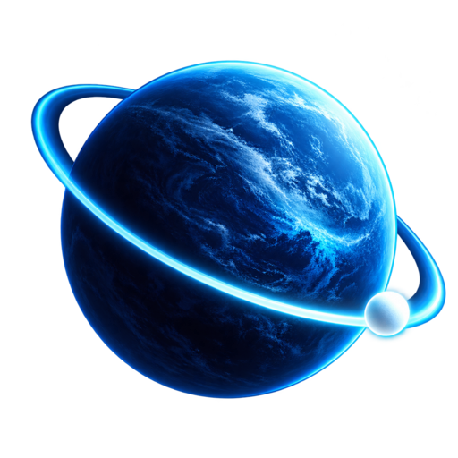
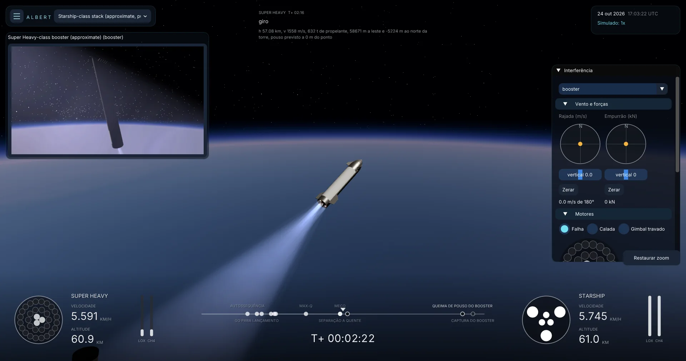
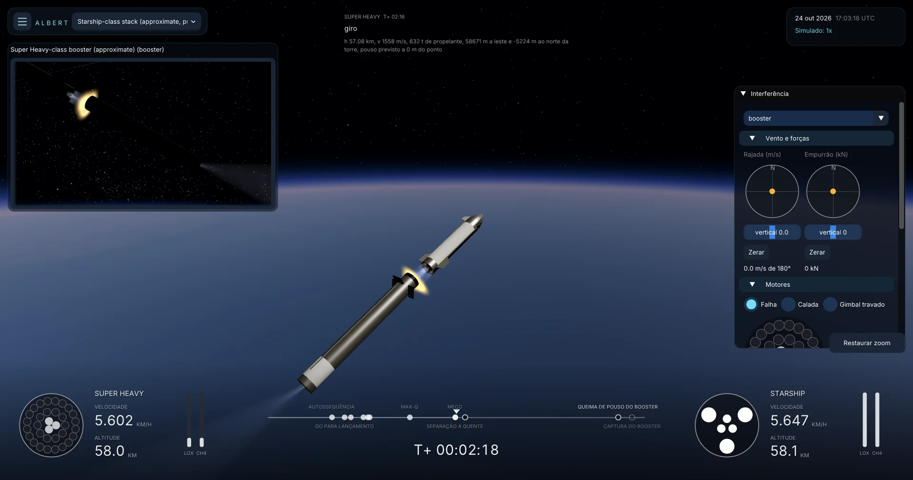
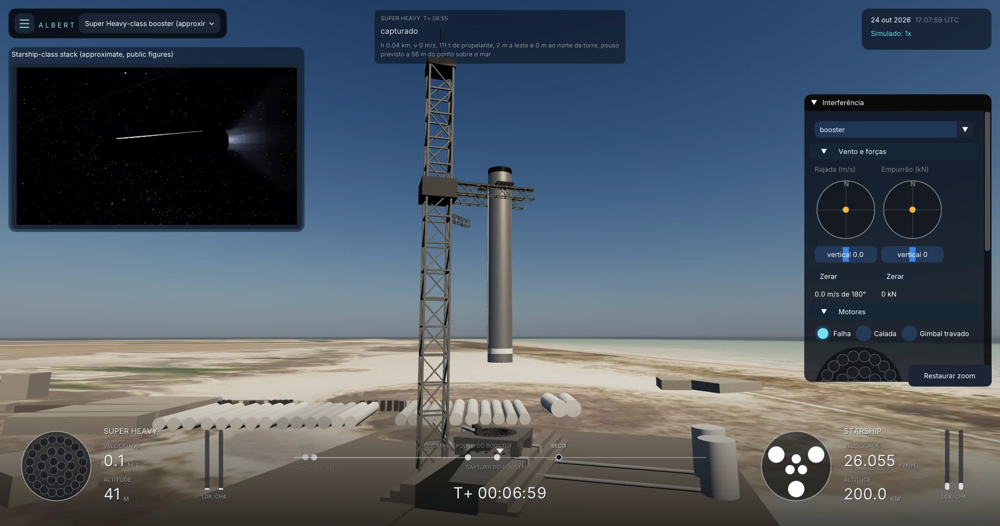
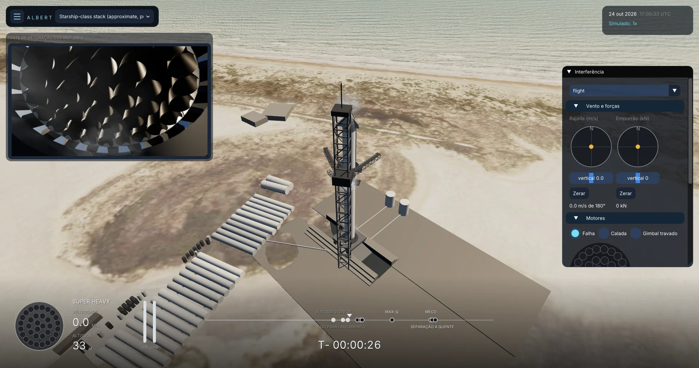
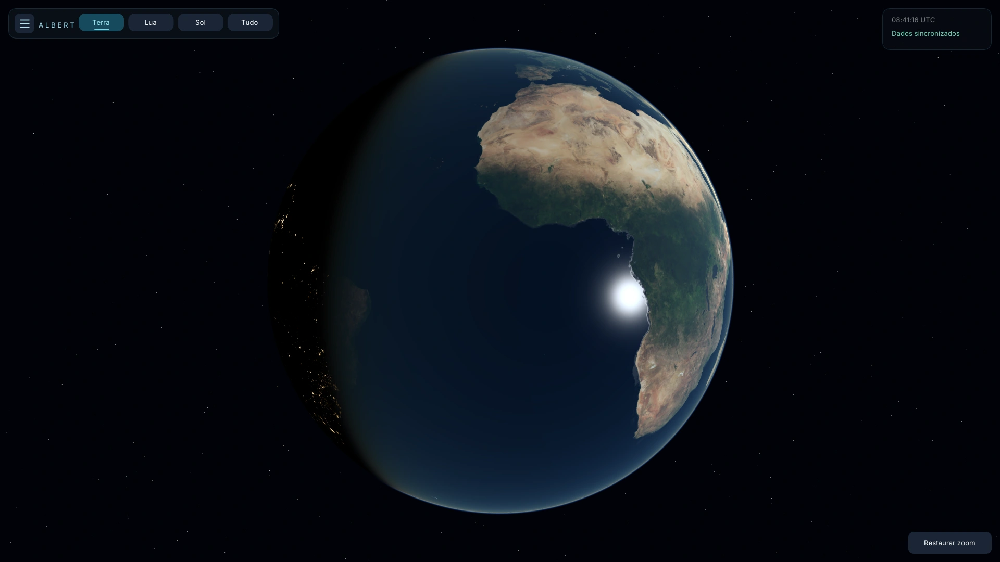
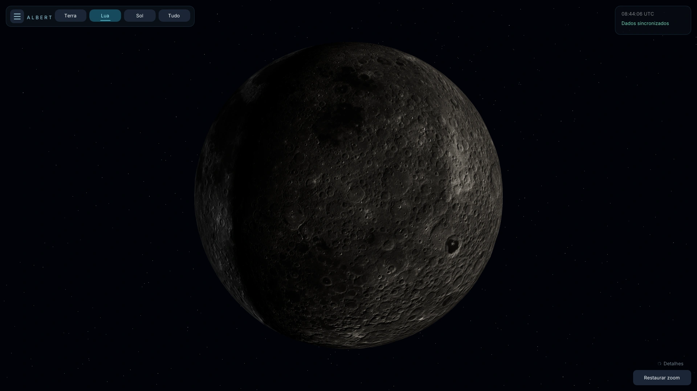

<p align="center">
  
</p>

<h1 align="center">Albert Engine</h1>

<p align="center"><b>O universo real em 3D, em tempo real — com física de verdade para voar nele.</b></p>

<p align="center">
  <a href="https://github.com/AllanOliveiraM/albert-engine/actions/workflows/build.yml"></a>
  <a href="https://github.com/AllanOliveiraM/albert-engine/releases"></a>
</p>

<p align="center"><sub>Feito por Allan Oliveira com IA: <b>Claude Opus 5.5</b> no Claude Code e <b>GPT-6.1 Sol</b> no Codex.</sub></p>

<p align="center">
  <a href="docs/images/starship-separacao.webp"></a>
</p>
<p align="center">
  <a href="docs/images/starship-separacao-quente.webp"></a>
  <a href="docs/images/booster-captura.webp"></a>
  <a href="docs/images/starship-pad.webp"></a>
</p>
<p align="center">
  <a href="docs/images/earth.webp"></a>
  <a href="docs/images/moon.webp"></a>
</p>
<p align="center"><em>Capturas reais do Albert.</em></p>

## O que ele faz

- **O céu de verdade, agora.** Sol, planetas, 25 luas, cometas e asteroides, de 1900 a 2100, com o horário conferido por NTP. Sol, planetas e Lua usam efemérides NASA/JPL Horizons; os demais corpos usam órbitas aproximadas embarcadas.
- **A Terra viva.** Relevo Copernicus de 30 m, atmosfera, nuvens e tempo ao vivo, oceano com ondas.
- **Um laboratório de física de voo.** Foguetes do pad à órbita: aerodinâmica, aquecimento na reentrada, massa variável, sensores simulados (IMU, GNSS, medidores), falhas e FDIR.
- **Software de voo de fora.** O voo é comandado por um programa externo pela API gRPC, que só enxerga os sensores, como um computador de voo de verdade.
- **Starship completo.** Contagem, decolagem com 33 Raptors, separação a quente, booster de volta à torre e, um dia depois, a nave voltando da órbita, ambos capturados nos braços.
- **Apollo 11, Lua e Marte.** O Saturn V do AS-506 pelo seu programa de voo, e subidas da Lua e de Jezero.

## Baixar e rodar

Baixe a versão do seu sistema na página de [**Releases**](https://github.com/AllanOliveiraM/albert-engine/releases):

| Sistema | O que baixar | Como abrir |
| --- | --- | --- |
| **Windows 10/11 x64** | todos os volumes `AlbertEngine-<versão>-windows-x64.zip.001`, `.zip.002`… | abra o `.zip.001` com o [7-Zip](https://www.7-zip.org/), extraia e execute **AlbertEngine.exe** |
| **Linux x64** (glibc 2.36+, como Ubuntu 24.04+, Debian 12+ e Fedora recente) | todos os volumes `AlbertEngine-<versão>-linux-x64.zip.001`, `.zip.002`… | extraia o `.zip.001` com o 7-Zip (`7z x`) e execute **./AlbertEngine** |

Substitua `<versão>` pela tag da release, como `v0.2.1`, e baixe todos os volumes do mesmo pacote na mesma pasta.
A versão **leve** acrescenta `-light` ao nome, antes de `.zip`: baixa as imagens essenciais ao abrir e completa o restante em segundo plano. A **completa** já inclui a biblioteca visual. Se houver um único `.zip`, extraia normalmente. Os arquivos `.sha256` permitem conferir os downloads.

Não precisa instalar o Albert; mantenha a pasta inteira junta. Requer GPU com **Vulkan** (Linux) ou **Direct3D 12/Vulkan** (Windows); adaptadores por software (lavapipe ou WARP) também servem, mais lentos. No Linux, precisa de X11 ou XWayland. A internet é usada para os dados astronômicos e, na versão leve, para baixar as imagens.

## Ver uma missão Starship

O cliente de exemplo precisa ser compilado: `make build` no Linux ou `.\make.cmd build` no Windows, após a preparação descrita em [Compilar](#compilar). Ele não acompanha os pacotes de release.

Na raiz do projeto, abra o Albert com o servidor de voo e rode o computador de voo de exemplo em outro terminal:

```sh
./build/linux/bin/AlbertEngine --rpc
./build/linux/src/rpc/albert_flight_client --starship   # a missão inteira, com os trechos orbitais acelerados
./build/linux/src/rpc/albert_flight_client --starship --utc=1792861200   # a mesma missão, em 24/10/2026 às 17:00 UTC (de dia em Starbase)
```

No Windows (PowerShell):

```powershell
.\build\windows\bin\Release\AlbertEngine.exe --rpc
.\build\windows\src\rpc\Release\albert_flight_client.exe --starship
```

Os dois comandos Linux do cliente são alternativas. `--utc=` recebe segundos Unix; `--warp=1000` é o padrão para a espera em órbita. Use `--warp=1` para acompanhar toda a missão em tempo real.

Outros voos: `--apollo11`, `--body=moon`, `--body=mars`, `--ship-return` (só a volta da nave) e `--fail=booster@landing:1` (falha do motor 1 do booster na queima de pouso).
Durante o voo, o painel **Interferência** permite soprar rajadas, empurrar o veículo e falhar motores e sensores ao vivo.

## Compilar

```sh
git clone https://github.com/AllanOliveiraM/albert-engine.git
cd albert-engine
```

Linux (Ubuntu 24.04+, Debian 12+ ou Fedora):

```sh
bash scripts/setup-linux.sh
make run
```

Windows 10/11 (PowerShell, com Git para Windows e Git LFS instalados):

```powershell
.\make.cmd setup
.\make.cmd run
```

A preparação instala as ferramentas e baixa a biblioteca visual (**5,45 GB via Git LFS**); pode pedir permissão de administrador. A primeira compilação também baixa e compila as dependências e pode levar vários minutos.
Detalhes, testes e solução de problemas em [DEVELOPMENT.md](docs/DEVELOPMENT.md).

<details>
<summary><b>Os corpos celestes e seus dados</b></summary>

O Albert Engine é um simulador astronômico escrito em C++20.

Hoje, a cena inclui **43 corpos**: o Sol, oito planetas, 25 luas, cinco planetas
anões, Vesta, Pallas, Halley e 67P. A seleção é local, organizada por categorias,
e aceita nomes aproximados. Luas adicionais, planetas anões e pequenos corpos
usam órbitas aproximadas embarcadas. Vinte e uma luas adicionais já têm mapas
próprios NASA, detalhes por zoom e orientação IAU; outras superfícies adicionais
continuam ilustrativas. Fobos e Deimos usam modelos de forma medidos de missões,
com mapas Viking; o alinhamento das imagens sobre esses modelos ainda exige validação.
Mimas usa a forma medida de Gaskell e o mosaico Cassini em cores realçadas,
reprojetado e alinhado à forma, com conferência por crateras catalogadas pela IAU.
Febe usa a forma medida de Gaskell e o mapa Cassini de 2005; as áreas nunca
observadas aparecem em cinza neutro, identificadas no painel. Hipérion usa a forma
medida de Thomas com a cor média medida pela Cassini, sem mapa de albedo; como sua
rotação é caótica, a orientação é ilustrativa. Proteu usa a forma de Stooke derivada
das imagens da Voyager 2, com cor neutra uniforme e sem mapa de albedo. Nereida, que
nunca foi resolvida em imagem, aparece como esfera com o albedo medido e um aviso.
Vesta e Ceres usam o mosaico e o relevo medidos pela sonda Dawn, e Plutão e Caronte
os da New Horizons, com detalhe por zoom; o sul de Plutão, em noite polar no sobrevoo, aparece
em cinza neutro.
O cometa 67P usa a forma medida pela câmera OSIRIS da Rosetta, com a cor escura do
núcleo medida pela missão; Halley usa a forma estimada com as imagens da Giotto e
das Vega, muito incerta, com rotação ilustrativa.
Júpiter, Urano e Netuno têm os anéis das tabelas do PDS, tênues como na realidade, com
uma opção de realce no painel do planeta.
Titã aparece como em luz visível, coberta pela névoa alaranjada; a superfície em
infravermelho (938 nm) da Cassini é uma opção identificada no painel.
Os oito planetas e a Lua preservam suas efemérides Horizons
e mapas próprios.
Os cinturões de asteroides e Kuiper e a nuvem de Oort são populações visuais
estatísticas, exibidas conforme a escala, sem representar trajetórias individuais.
Objetos próprios podem ser criados pela API como esferas, caixas, cilindros ou
modelos GLB estáticos. Consultas/importações online ficam disponíveis pela API;
a interface não busca objetos na internet.
Novos planetas, luas, anéis, camadas de mapas e provedores de dados estão no
[roadmap](ROADMAP.md).

</details>

<details>
<summary><b>Como funciona</b></summary>

**O tempo e os dados definem a cena.** O Albert consulta as posições e trajetórias do Sol, dos planetas e da Lua no Horizons. Entre consultas, interpola
as amostras para manter o movimento contínuo. A orientação dos corpos usa
transformações astronômicas; a Terra considera o modelo WGS84.

**A data pode ser escolhida.** Clique no horário, no canto superior direito, para
pausar, voltar no tempo, acelerar até uma semana por segundo ou ir a um instante de
1900 a 2100 (UTC); **Agora** retorna ao tempo real. Sol, Lua e planetas usam as
efemérides do Horizons para a data escolhida. Enquanto as tabelas chegam, e acima
de 6 horas por segundo, eles seguem modelos analíticos do ERFA ajustados às
últimas tabelas, e o painel indica **Posições aproximadas**. Outras luas e os
pequenos corpos usam órbitas de dois corpos, menos precisas longe da época dos
elementos (outubro de 2026). As nuvens observadas aparecem só perto do presente.
Objetos enviados pela API são avaliados no instante simulado.

O horário é conferido automaticamente com **fontes NTP independentes** e
continua avançando entre consultas. Se a rede falhar, a interface informa quando
o horário é estimado ou local. Fonte e qualidade ficam em **Dados** e também
estão disponíveis pela API. Esta versão ainda não autentica NTP com NTS;
[funcionamento e limites](docs/TIME.md).

**As imagens estáticas ficam no computador, completas ou baixadas aos poucos.**
Superfícies, luzes das cidades, relevo e referência solar formam uma biblioteca de
aproximadamente **5,45 GB**. A versão completa a traz em um único `assets/visuals.pak`
e funciona offline. A versão leve baixa ao abrir só o essencial (~78 MB, todos os
corpos em resolução global) e completa as demais resoluções em segundo plano, com
o corpo em foco à frente; o canto inferior esquerdo mostra o andamento. Aproximar
a câmera carrega recortes mais detalhados; a resolução máxima depende dos dados de
origem e, na versão leve, do que já chegou.

**Os recursos entram conforme a necessidade.** O Albert prepara os detalhes em
segundo plano e divide o envio de texturas à GPU entre quadros, mantendo a
superfície anterior enquanto a nova fica pronta. A origem gráfica acompanha o
alvo para preservar detalhes pequenos em distâncias astronômicas.
Ao afastar a câmera ou mudar de objeto, os recortes de alta resolução são
liberados após um breve intervalo, reduzindo o consumo de memória.

**Os downloads recentes são reutilizados.** Posições e órbitas ficam salvas
entre execuções. Se os dados ainda cobrem o horário atual, a cena pode abrir
com eles e renovar as consultas em segundo plano. Tabelas expiradas ou
corrompidas são descartadas. Sem tabela para o instante, as posições vêm dos
modelos analíticos citados acima, sempre identificadas como aproximadas. A
primeira abertura ainda precisa buscar os dados.

**As nuvens são observações com atraso.** Elas começam desligadas. Quando
ativadas, o Albert consulta mosaicos de satélite, mostra a data em **Dados** e
mantém um cache de downloads. O limite padrão é 2 GB e pode ser ajustado no menu.
Em **Dados**, você pode consultar o espaço ocupado, limitar ou limpar o cache
de posições, órbitas, buscas e nuvens sem apagar as imagens incluídas.
A aparência solar e os mosaicos de superfície são referências estáticas.
Nos novos planetas, os mapas têm resoluções de 1K a 32K e não incluem
relevo medido. Os gigantes e Vênus usam referências visuais de atmosfera;
as nuvens desses corpos não são atualizadas ao vivo. Consulte
[fontes e limites dos mapas](docs/PLANETARY_ASSETS.md).

**O catálogo offline distingue aproximação de efeméride.** Os 33 corpos
adicionais são propagados a partir de elementos orbitais osculantes de
16/10/2026. A aproximação de dois corpos não integra perturbações e sua precisão
diminui longe dessa época. Os nomes e categorias estão disponíveis sem consultas
online. [Fontes, reprodução e limites](docs/LOCAL_SYSTEM.md).

**A interface e o gRPC compartilham a mesma cena.** Um cliente externo pode
criar um veículo, enviar sua posição e orientação e solicitar acompanhamento.
Você continua podendo orbitar e aproximar a câmera durante esse movimento.
Os formatos e limites disponíveis estão em [RPC.md](docs/RPC.md).

</details>

<details>
<summary><b>Navegar e ajustar a imagem</b></summary>

- Clique no nome do objeto na barra superior: busque planetas e luas ou escolha **Tudo**.
- Objetos adicionais podem ser consultados e importados pela API gRPC; a busca da interface usa o catálogo local.
- Arraste para girar e use a roda do mouse para aproximar.
- Use o botão **Restaurar zoom**, no canto inferior direito, para voltar à distância inicial.
- Clique no horário, no canto superior direito, para escolher data e velocidade; **Agora** volta ao tempo real.
- Em **Eventos**, no mesmo painel, vá direto a eclipses (2024, 2026, 2027), ao pouso da Apollo 11, à passagem da Giotto pelo Halley ou ao periélio da 67P.
- Na 67P ou no Halley perto do periélio (por exemplo 2021-11-02 ou 1986-03-13), ative **Realçar coma e caudas** e afaste a câmera.
- Abra **Menu → Ajustes** para ajustar atmosfera, nuvens, cidades, fronteiras, sombras e órbitas.
- Ative **Nuvens em tempo real** em **Ajustes** para buscar as observações automaticamente.
- O brilho auxiliar de cada objeto com lado escuro ajuda a enxergar o lado escuro; começa desligado e é ajustável.
- Em **Dados**, acompanhe as atualizações, retente consultas e gerencie o cache.
- Em **Dados → Manutenção das nuvens**, recarregue as texturas ou limpe e baixe as nuvens novamente.

</details>

<details>
<summary><b>Programar cenas e voos com gRPC</b></summary>

Compile o projeto completo e abra o servidor local:

```sh
make build
./build/linux/bin/AlbertEngine --rpc
```

Em outro terminal, execute o cliente de exemplo:

```sh
./build/linux/src/rpc/albert_demo_client
```

Ele cria um cilindro representando um veículo, foca a câmera e transmite
posição e orientação por cerca de dez segundos. Os dados são **sintéticos**,
identificados como demonstração. A última posição permanece visível ao terminar.

O servidor é ativado com `--rpc` e aceita conexões em `127.0.0.1`.
O [guia gRPC](docs/RPC.md) traz os comandos Windows, contrato, coordenadas,
limites, streaming e remoção do exemplo.

**Voo físico.** `albert_flight_client` faz o papel de um computador de voo externo:
lê os sensores simulados (IMU, pressão, posição) e comanda motor, cardã e
estagiamento de um lançador genérico de dois estágios, de Kennedy até a órbita, passo a
passo. O Albert integra o voo (gravidade, atmosfera padrão, rotação da Terra, massa
variável) e mostra o veículo na cena:

```sh
./build/linux/src/rpc/albert_flight_client               # Kennedy → órbita terrestre
./build/linux/src/rpc/albert_flight_client --body=moon   # Base da Tranquilidade → órbita lunar
./build/linux/src/rpc/albert_flight_client --body=mars   # cratera Jezero → órbita de Marte
./build/linux/src/rpc/albert_flight_client --apollo11    # Saturn V do Apollo 11 → órbita de estacionamento
./build/linux/src/rpc/albert_flight_client --starship    # Starship de Starbase: booster e, um dia depois, nave capturados na torre
```

O `--apollo11` voa o Saturn V AS-506, montado a partir do relatório de avaliação de voo da NASA, pelo
programa de voo da época (examples/saturn_v.hpp). A partir do estado real na separação do S-IC, o
Albert chega ao fim do S-II a 0,3 m/s da velocidade medida e corta o S-IVB 1,9 s depois do voo, numa
órbita de 186,5 × 183,1 km (Apollo 11: 186,0 × 183,2 km).

O `--starship` voa um Starship montado só com a física genérica, por definições na API (nada dele no núcleo; valores
públicos aproximados da V3 em examples/starship.hpp). A pilha sobe com 33 Raptor 3 e separa a quente aos 136 s, a 63 km.
A nave segue até uma órbita de 181 × 214 km. O Super Heavy vira outro voo e volta à torre: boostback de ~55 s, apogeu de
~100 km, descida guiada pelas três grid fins, queima de pouso em 13 e depois 3 motores (~25 s até sobre os braços, como nos
voos de 2025) e captura nos braços, a 0,4 m do eixo da torre, com 52 t de sobra. A guiagem decide em tempo real: se a
captura deixa de ser possível (motores, propelante, alcance), desiste e cai longe da torre ou no mar. Tirado o booster dos braços, a nave espera em órbita a passagem que a traz de volta sobre Starbase, cerca de 22 h
depois. Então queima para sair de órbita, reentra de barriga guiada pela inclinação lateral, com flaps e RCS segurando a
atitude e o escudo térmico abaixo do limite. Ela se vira para os motores, queima para pousar e é capturada nos mesmos braços.
Em tempo real, a órbita passa acelerada (`--warp=1000`, o padrão) e o trecho balístico do retorno em até 60×; as manobras, a reentrada e o pouso ficam em 1×. `--follow-booster` leva a câmera para o
booster na separação. Os veículos aparecem como são definidos: corpo, flaps e grid fins mexendo, sinos com o cardã, plumas
que se abrem no vácuo e jatos do RCS. Starbase está no chão: a torre, os braços (abertos na subida, fechando em volta do
booster e da nave que pairam), a mesa de lançamento, os tanques. `--pad` mostra a pilha na mesa, com a câmera dando a volta. Os guiamentos aguentam motores falhando (`--fail=booster@landing:1`
e outras): trocam o motor perdido por outro e seguem até a captura ou, quando ela fica impossível, abortam para longe da
torre.

Com dois voos ou mais, um quadro no canto mostra o outro voo ("Segunda vista dos voos" em Ajustes), com sua própria câmera
presa ao veículo; um clique nele passa a seguir aquele voo. Como numa transmissão, cada veículo tem seu painel embaixo
(velocidade em km/h, ou m/s abaixo de 100 m/s; altitude; LOX e CH4; os motores vistos de baixo, acesos, apagados ou em falha),
e no meio ficam o relógio T± da missão (a contagem regressiva antes da decolagem) e os eventos que o programa de voo informa
(`StepRequest.milestones`).

Durante um voo, o painel **Interferência** (Ajustes: "Painel de interferência") mexe nele ao vivo, pelos mesmos comandos da
API:

- rajadas de vento e empurrões por dois joysticks (norte/leste) e controles verticais;
- o mapa de motores do voo escolhido: um clique faz um falhar, falhar calado (ele diz que está bem) ou travar o cardã, como
  escolhido acima dele; o botão direito faz falhar calado; as superfícies (grid fins, flaps) travadas onde estão;
- cada sensor falhando ou mentindo (morto, travado, com viés, derivando, com ruído), cada unidade de IMU à parte;
- SEGURAR e RETOMAR a contagem regressiva, ABORTAR (o software de voo toma a saída mais segura para a fase: na contagem,
  cancela; na ignição, aborta na plataforma), uma mensagem livre e a terminação do voo (com confirmação).

Em Ajustes ficam as opções de gráficos, Terra, vista, câmera e som (guardadas entre execuções), e a câmera livre: F liga,
arrastar olha, W/A/S/D/Espaço/Ctrl voam, com a velocidade pela altura, como no Kerbal Space Program; F ou Esc volta.

Com "Som do voo" ligado no menu (o Albert começa mudo), a câmera ouve os foguetes: ruído pelo modelo da NASA (SP-8072),
com o atraso da distância, a absorção do ar do caminho e o Doppler; a 1, 5 e 10 km de um Starship o nível fica a menos de
1 dB do medido. Perto e alto, os motores crepitam; longe, sobra o ronco grave. Booster e nave se ouvem juntos, cada um do
seu lado. O ar que passa pelo veículo ruge na descida, e quando o cone de Mach de um veículo supersônico passa pela câmera,
vem o estrondo (método de Carlson, da NASA). No vácuo, silêncio.

`albert_landing_client` faz o mesmo na Lua: o módulo de pouso genérico sai das pernas na Base da
Tranquilidade (altura do LOLA), sobe a 150 m, paira e pousa a menos de 1 m/s:

```sh
./build/linux/src/rpc/albert_landing_client
```

Os veículos genéricos usam números públicos aproximados; não representam veículos reais.

Essa base permite construir integradores de simulação e ferramentas educativas.
O primeiro catálogo interno já reutiliza o Horizons. O suporte inicial a GLB estático também está disponível. Pontos e linhas geográficas também podem ser adicionados por gRPC.
Texturas/animação de modelos, polígonos, rótulos, camadas raster e novas fontes
públicas são próximas entregas.

</details>

## Documentação

[Roadmap](ROADMAP.md) · [Física de voo](docs/PHYSICS.md) · [API gRPC](docs/RPC.md) · [Desenvolvimento](docs/DEVELOPMENT.md) · [Fontes dos dados](assets/README.md) · [Créditos](THIRD_PARTY.md)
