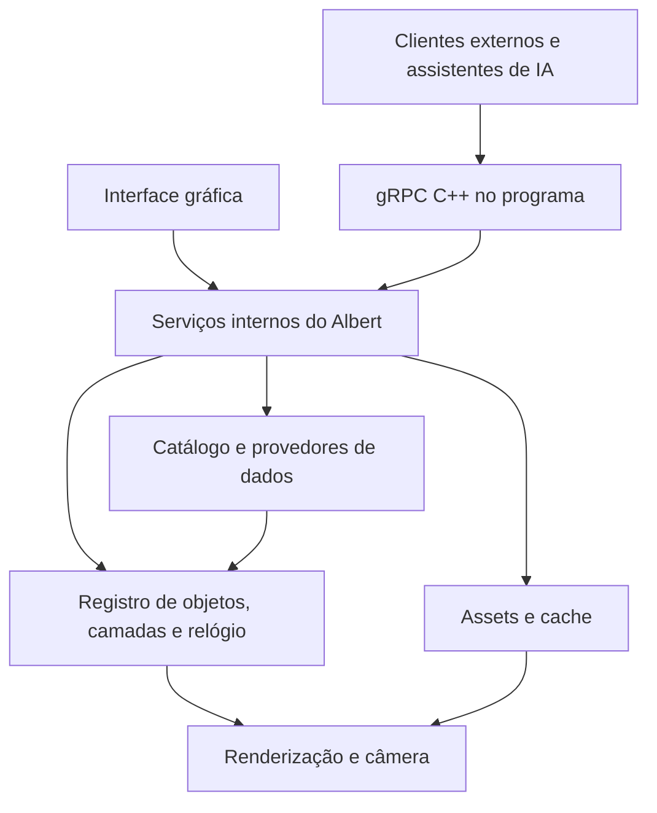

# Albert Engine — plano de evolução

Documento de planejamento e acompanhamento, atualizado em **17/10/2026**.
A seção de andamento registra as entregas realizadas. Os demais requisitos
formam o backlog para entregas incrementais conforme as prioridades acordadas.
Este documento reúne os pedidos, a proposta de arquitetura
e os critérios para orientar as próximas implementações.

### Prioridades atuais — o que ainda falta

Esta fila prevalece sobre a ordem histórica do backlog abaixo. Um primeiro
corte entregue não significa suporte completo a todos os requisitos da feature.

| Prioridade | Próxima entrega | Limite do que existe hoje |
| --- | --- | --- |
| **Alta — 1** | Completar Hipérion, Proteu e Nereida | Lua terrestre detalhada; 21 luas adicionais com mapas/IAU (Titã com névoa visível e superfície em 938 nm); Fobos/Deimos/Mimas/Febe com formas medidas; demais luas ilustrativas; eclipses adicionais pendentes |
| **Alta — 2** | Lapidar cometas, asteroides e luas irregulares; eliminar esferas genéricas onde a forma pede irregularidade | Halley/67P/Vesta/Pallas/Hipérion já têm malhas artísticas individuais; melhorar materiais, formas e detalhe por zoom; coma/caudas ainda faltam |
| **Alta — 3** | Anéis de Júpiter, Urano e Netuno, incluindo orientação, perfis e oclusão | Somente Saturno tem anéis; não reaproveitar seu perfil nos outros planetas |
| **Alta — 4** | Mais qualidade em planetas/anões e modelos observados dos pequenos corpos | Resolução varia muito; rochas procedurais são arte, não reconstruções reais |
| **Alta — 5** | Validar GPU física, Windows nativo (inclui a versão leve e seus downloads) e orçamentos de RAM/VRAM em viagens extensas | MinGW/Wine e OpenGL por software não substituem esses ambientes |
| **Média — 1** | Efemérides/orientações locais mais precisas para luas e pequenos corpos, avaliando SPICE | Catálogo adicional usa propagação aproximada de dois corpos |
| **Média — 2** | NTS e tratamento completo de leap seconds/smear | NTP com múltiplas fontes já existe, sem autenticação criptográfica |
| **Média — 3** | Texturas GLB/glTF, animação de peças e controles avançados de câmera pela API | GLB estático/PBR sólido e streaming de posição/atitude já existem |
| **Média — 4** | Rótulos, polígonos/GeoJSON e camadas raster/clima selecionadas | Camadas atuais: pontos e polilinhas; nuvens GIBS continuam opcionais |
| **Média — 5** | Data de simulação, gravação/reprodução e cenários de eventos/eclipses | Eclipses acompanham a geometria em tempo real; não há seletor de datas históricas |
| **Posterior** | Satélites artificiais/OMM, mais provedores e exemplos de assistente de IA | Catálogo extra permanece na API; não reintroduzir importação online na UI |

### Download dos assets por níveis — decidido e entregue em 17/10/2026

O Allan aprovou trocar a biblioteca embutida por um download no primeiro uso,
organizado por nível de resolução. Ordem combinada: concluir Mimas (entregue em
17/10/2026), implementar este download e então retomar as luas restantes.

- **Hospedagem:** anexos de uma release própria de assets no GitHub, publicada
  somente quando os assets mudam. Anexos de release não têm limite de banda;
  o LFS do repositório não serve, pois cada download gastaria a cota da conta.
  O executável conhece os hashes esperados e recusa dados de outra versão.
- **Tela de loading dedicada** apenas para o essencial, cerca de 80 MB: nível
  global de todos os corpos (Terra 5400 px, Lua 6750 px, Mercúrio 5760 px),
  luas pequenas e malhas medidas. Todo o Sistema Solar fica navegável.
- **Segundo plano por nível:** Terra/Lua nível 1, depois nível 2 e seguintes;
  depois Mercúrio e Marte. O corpo em foco passa à frente da fila. Indicador
  elegante e minimalista no canto, com retentativa e continuação.
- **O zoom é que fica limitado, não o corpo:** sem o detalhe, mostra-se a melhor
  resolução já baixada, nunca imagem inventada; o indicador informa o andamento.
- **Containers por corpo e nível**, cada um com índice e SHA-256 e abaixo do
  limite de 2 GiB por anexo. Retomada por HTTP Range com `.part`, verificação
  antes de liberar o nível, retomada ao reabrir; arquivos em `assets/` ao lado
  do executável, preservando a distribuição portátil.
- Medição de 17/10/2026: Terra+Lua completas somam 2,85 GB, por isso a
  prioridade é por nível, não por corpo. O nível 4 concentra cerca de 3,1 GB.

### Pequenos corpos artísticos — prioridade alta

O primeiro corte já existe: malhas irregulares próprias para Vesta, Pallas,
Halley, 67P, Hipérion e Febe; 67P tem dois lobos, Halley é alongado. Crateras,
variações de material e microrelevo são procedurais e identificados como arte.

Próximo corte: silhuetas e materiais mais característicos por objeto, detalhes
por zoom sem picos de memória e coma/caudas de cometas quando aplicáveis,
com comportamento coerente com a geometria solar e limites dos dados disponíveis.
Não afirmar atividade observada a partir de um efeito artístico. Preferir modelos
medidos quando disponíveis, com proveniência e escala verificadas. Preservar o
raio nominal, a seleção e a distância segura da câmera ao trocar a representação.
Objetos fisicamente arredondados podem manter esfera/elipsoide apropriado;
o critério é a forma do corpo, não deformar todos os objetos indistintamente.

### Ordem das luas pendentes

Das 25 luas do catálogo, 21 têm mapas próprios, incluindo a Lua terrestre.
Isso não significa geometria, relevo, cor ou cobertura completos.

Fobos e Deimos já têm modelos medidos DSK; registro dos mosaicos Viking sobre
as malhas ainda requer conferência cartográfica. A próxima fila é:

1. ~~**Mimas**~~ — entregue em 17/10/2026: forma medida e mosaico registrado.
2. ~~**Titã**~~ — entregue em 17/10/2026: névoa visível e superfície em 938 nm opcional.
3. **Hipérion** (Febe entregue em 17/10/2026): modelo irregular e imagem próprios, substituindo o procedural.
4. **Proteu:** modelo e cobertura de imagens disponíveis, explicitando lacunas.
5. **Nereida:** representação limitada aos dados disponíveis, sem inventar detalhes observados.

Os três corpos ainda sem mapas/modelos próprios embarcados são Hipérion, Proteu e
Nereida. A forma artística e a esfera de referência
continuam identificadas como aproximações até cada substituição.

### Andamento

**17/10 — Febe com forma medida e mapa Cassini.** Modelo de Gaskell (PDS, 208 imagens
Cassini ISS), Q=128: 98.306 vértices e 196.608 triângulos em metros, sem renormalizar
ou recentrar, no lugar da rocha procedural. Mapa PIA07775 (NASA/JPL/SSI, 2005), recortado
da moldura; as áreas nunca observadas (norte de ~60° N e sul de 81° S) recebem a média
local das observações vizinhas, dissolvida no cinza mediano, sem detalhe inventado, e o
painel avisa. A correlação com o sombreamento da malha em 58 regiões não aponta correção
significativa (incerteza ~2°), então a grade publicada foi mantida. UVs de polos medidos
a até ~130 m do eixo corrigidas, com regressão. Validação: 27 testes Linux, 96
interseções independentes, OpenGL no Xvfb e no Wine, CSPICE no Wine e programa real
focando Febe. Pacote das luas: 73,31 MB; biblioteca reunida: 4,90 GB. Sem novas distribuições.

**17/10 — Titã em luz visível e superfície em 938 nm.** Por padrão, névoa opaca
alaranjada com cor medida na composição Cassini em cor natural (PIA06230), luz além
do terminador e casca de névoa: limbo difuso e camada alta azulada com espalhamento
frontal, tênue em fase moderada e brilhante contra o Sol. Opção identificada no
painel: mosaico Cassini ISS de 938 nm (PIA22770), registro conferido em 12 feições
do Gazetteer. Detalhe regional só no modo superfície. Testes de névoa/superfície no
OpenGL (Linux e Wine) e orientação contra CSPICE. Pacote das luas: 68,97 MB.

**17/10 — revisão do Codex e CI Windows.** Três achados confirmados e corrigidos
(verificação SHA-256 dos containers em disco, refresh após troca de foco, release de
assets completa antes da versão). O build MSVC compilou e linkou pela primeira vez.

**17/10 — download dos assets por níveis.** Versão leve com `assets/catalog.json`:
essencial de 63 MB na tela de carregamento, 18 containers por corpo/nível em
segundo plano, foco à frente (inclusive interrompendo a transferência atual sem
perda), HTTP Range com `.part`, SHA-256 incremental, troca atômica da biblioteca,
reserva de disco e indicador no canto. O leitor usa a melhor resolução já
baixada, nunca inventa detalhe. Releases publicam versões completa e leve e,
quando necessário, a release `assets-<id>`. Teste do app real contra servidor
local: cena em 16,9 s, 19 containers em 235 s a 25 MB/s e retomada após reinício.
Ainda falta validar em Windows nativo e contra uma release real do GitHub.

**17/10 — Mimas com forma medida e mosaico registrado.** Modelo de Gaskell
(PDS, Cassini ISS e Voyager 1), Q=256: 393.218 vértices e 786.432 triângulos em
metros, sem renormalizar ou recentrar. Mosaico Cassini PIA18437 (NASA/JPL/SSI/LPI)
de 6356×3178 em cores realçadas IR–verde–UV, identificado como tal na interface.
O mosaico publicado estava deslocado −3,85° em longitude e usa latitude
planetográfica (tan φ' = (207,8/190,6)² tan φ); o gerador o reamostra sobre a forma.
A correlação com o sombreamento da malha em 84 regiões subiu de 0,04 para 0,51;
21 crateras do Gazetteer confirmam a malha (mediana +0,40°/−0,34°).
`scripts/register-moon-map.py` reproduz a análise. Aviso por fonte (`notice`)
passou a vir do inventário. Polos medidos a poucos metros do eixo agora recebem
tratamento de polo nas UVs. Validação: 25 testes Linux, 72 interseções
independentes (CSPICE e float64), OpenGL no Xvfb e programa real focando Mimas.
Pacote das luas: 65,47 MB; biblioteca reunida: 4,89 GB. Sem novas distribuições.

**17/10 — CI do Windows e cache.** A montagem PowerShell falhava com o pacote de
2,86 GB (sobrecarga `Int32` de `Math.Min`); a versão corrigida produz bytes
idênticos aos do Linux. O CI passa a reutilizar os objetos LFS (que contam na cota
de banda da conta), ccache no Linux e a árvore de dependências no Windows, e um
push novo cancela o build anterior da mesma branch.

**Modelos medidos de Fobos e Deimos.** Fobos usa DLR/NAIF 2014 (274.874
triângulos) e Deimos, Thomas/ESA v0.2 (5.040 triângulos). Coordenadas originais
IAU, convertidas de km para metros sem normalizar escala ou recentrar o corpo.
Pacote binário indexado e BVH preparados no worker; seleção respeita a malha
real. Detalhes regionais trocam somente texturas, com fade/upload incremental,
sem sobrepor esfera ao modelo. Câmera considera o raio máximo medido.

Validação: 23 testes Linux, 48 interseções comparadas com CSPICE/DSKX02,
regressões OpenGL e build MinGW; gráficos e geometria Windows pelo Wine.
Mosaicos Viking mantêm iluminação herdada e registro sobre a malha ainda não
validado. Posições adicionais continuam aproximadas. Pacote das luas: 43,83 MB;
biblioteca reunida: 4,87 GB. Sem novas distribuições.

**16/10 — primeiro aprimoramento de Fobos e Deimos.** Mosaicos próprios Viking
NASA/JPL/USGS de 1440×720, sem reutilizar imagens de outra lua. Formas elipsoidais
triaxiais com semieixos IAU pck00011, orientação física com termos periódicos e
argumentos quadráticos de Marte. Limite de câmera considera o maior semieixo,
e seleção/detalhes regionais respeitam a escala não uniforme. Substitui as
formas aleatórias quando os mapas estão presentes. Não é um modelo de relevo
observado: detalhes de forma, cor real/calibração e registro textura/geometria
continuam pendentes. São 18 luas adicionais com mapas; pacote conjunto 38,79 MB.

**16/10 — luas dos sistemas externos.** Ariel, Umbriel, Titânia, Oberon, Miranda,
Tritão e Caronte recebem mapas próprios NASA/VTAD e orientação IAU, incluindo
rotação retrógrada e termos periódicos. São 16 luas adicionais com mapas; pacote
conjunto de 38,13 MB. Cobertura parcial e resolução limitada ficam explícitas
na UI e no inventário. Regiões uniformes/borradas não são apresentadas como
terreno medido. Os sete mapas variam de 1024×512 a 4096×2048; sem DEM.
Restam Fobos/Deimos (formas, imagens e orientação observadas), Mimas (atlas),
Titã (atmosfera), Hyperion/Phoebe (formas observadas), Nereida/Proteus, relevo
e efemérides mais precisas e eclipses adicionais.

**16/10 — mapas das luas de Saturno.** Encélado, Tétis, Dione, Reia e Jápeto
recebem mapas próprios NASA/VTAD de 4096×2048 e orientação IAU pck00011,
incluindo termos periódicos quando publicados. São nove luas adicionais com
mapas embarcados; o pacote conjunto ocupa 34,98 MB. Mesma base de 1K, recortes
regionais, upload incremental, fade e descarte de memória do lote anterior.
Descritores agora são gerados diretamente do inventário de fontes, mantendo
separados o catálogo visual e os provedores de posições. Sem DEM dessas luas;
registro cartográfico e órbitas aproximadas continuam com os limites documentados.
Mimas (reprojeção de atlas), Titã (atmosfera), Hyperion/Phoebe (formas observadas),
luas dos outros sistemas e eclipses adicionais continuam pendentes.

**16/10 — primeiro lote de superfícies das luas.** Io e Europa com mapas NASA/VTAD
de 4096×2048; Ganimedes e Calisto, 2048×1024. Pacote local adicional de 8,51 MB,
fontes fixadas por SHA-256 e gerador reproduzível. Base de 1K por lua; detalhes
regionais por zoom com upload incremental, fade e descarte ao afastar/trocar foco.
Orientação IAU pck00011 verificada contra CSPICE em quatro épocas por corpo.
Catálogo de superfícies separado dos provedores de efemérides: não adiciona
downloads em runtime nem reclassifica luas como planetas. Não há DEM dessas luas;
mapas são referências visuais estáticas, com cobertura/resolução variável e
registro cartográfico ainda não validado. Órbitas continuam aproximadas offline.

**16/10 — lapidação de navegação, interface e fenômenos.** Menu contextual;
anotações abaixo dos painéis; órbitas acompanham a distância real até o corpo
desde a aproximação. Rótulos e órbitas secundários usam espaçamento em tela,
histerese e fade nas vistas gerais; catálogo e seleção direta continuam disponíveis.
Viagem com progresso adaptado às distâncias de saída/chegada, fases sobrepostas
e tempo gráfico limitado por quadro para não saltar após uploads. Órbita lenta
de apresentação após chegar a um corpo, cancelada por arraste, zoom ou comando
de órbita externo; vistas gerais permanecem estáticas.

Vesta, Pallas, Halley, 67P, Phobos, Deimos, Hyperion e Phoebe recebem formas
irregulares, crateras e material rochoso procedural por objeto. Representações
artísticas explícitas, centradas e com volume nominal preservado, sem novos
downloads nem imagens fictícias apresentadas como observações. Detalhes em
[LOCAL_SYSTEM.md](docs/LOCAL_SYSTEM.md).

Eclipses Terra/Lua usam sobreposição angular de um disco solar finito, com
umbra/penumbra/antumbra. A luz vermelha do eclipse lunar é uma aproximação
visual atmosférica documentada; detalhes regionais compartilham a mesma
oclusão. Fontes, limitações e validação em [ECLIPSES.md](docs/ECLIPSES.md).
Ícones nativos em 32/64/128 px; atalho Linux por usuário com `make desktop`
associa o ícone ao WM_CLASS, sem instalar o executável. Distribuições não foram geradas.

Validação desta rodada: 22 testes Linux, regressões OpenGL (incluindo eclipses
solar/lunar e rochas), build MinGW, gráficos e executável Windows pelo Wine.
Conferência integrada verificou órbita automática e parada com a roda física
do mouse, enquadramento da visão geral, menus contextuais, rótulos, pequenos
corpos e propriedades nativas do ícone. Na conferência final em 600×480 com
llvmpipe, pico de RSS próximo de 1,0 GiB; não é um teto de RAM nem uma medição
de VRAM/desempenho em GPU física.

**Prioridade alta — identidade visual das luas.** Substituir as superficies
genericas das luas adicionais por formas, cores, relevo e materiais semelhantes
aos corpos reais. Priorizar imagens e modelos de missões com proveniência e
licenças registradas; usar LOD e carregamento sob demanda no pacote local.
Quando não houver cobertura, identificar explicitamente a representação
artística e evitar inventar precisão. Começar por Io, Europa, Ganimedes,
Calisto, Titã, Encélado, Tritão, Caronte, Phobos e Deimos. Validar silhuetas,
orientação, transição de resolução e orçamento de RAM/VRAM. A Lua terrestre
já tem imagens e relevo próprios; as demais ainda exigem esse trabalho.

**Lacuna visual — outros sistemas de anéis.** Hoje somente Saturno tem anéis
renderizados. Incluir Júpiter, Urano e Netuno com raios e orientação de fontes
astronômicas, perfis sutis próprios e distinção entre luz visível e imagens
infravermelhas. Não reutilizar dimensões/opacidade de Saturno nos outros corpos.

**16/10 — navegação e conteúdo local (novo corte).** Retirada a busca/importação
online da interface; serviços continuam na API. Cena padrão com 43 corpos,
agrupamento por categoria, nomes aproximados (acentos/transposição), prioridade
por correspondência e distância heliocêntrica para desempate. As 24 novas luas,
cinco planetas anões, dois asteroides e dois cometas usam elementos Horizons
embarcados e propagação de dois corpos explicitamente aproximada. Os oito
planetas e a Lua mantêm o caminho de efemérides existente. Texturas e formas
próprias desses novos corpos continuam pendentes; esferas não são fotorealismo.

Órbita completa agora tem guia fina mais visível, além dos destaques locais de
passado/futuro. Traços crescem moderadamente com a aproximação. Vista dos
planetas internos, etiquetas clicáveis para luas com oclusão, câmera em fases
(afastar, alinhar, aproximar), conservando o easing. Cinturão principal, Kuiper
e nuvem de Oort entram como populações visuais estatísticas opcionais, sem
catálogo individual nem afirmação de densidade aparente real.

Marte passa de 1440×720 para 32768×16384 (Viking colorizado/Trek); Júpiter passa
para 6000×3000 (GSFC/SVS). Pacote solar de 275.610.368 bytes, biblioteca reunida
~4,82 GB. Geradores com processamento em faixas/VRT, validação de todos os blocos,
leitor concorrente com arquivo fixado e montagem que libera cache de arquivos
em lotes de 64 MiB. LOD escolhe fonte suficiente para o orçamento, sem ampliar
artificialmente. Terra/Lua: zoom mínimo ~64/20 km e malha regional até 384×384.

Validação automatizada: 22 testes CTest Linux, gerador de assets e teste OpenGL
passaram. MinGW e testes de pacote, catálogo offline e gráficos no Wine passaram.
Conferência integrada validou as vistas de escala, clique em Dione, busca de
Europa com “euorpa”, foco/zoom em Marte, Lua e Terra. Pico observado de cerca
de 1,02 GiB com llvmpipe. Execução completa Windows pelo Wine também passou.
Amostragem bilinear do DEM evita degraus artificiais ao subdividir a malha;
exposição fotográfica lunar própria e origem gráfica na câmera durante viagens.
GPU física e Windows nativo ainda exigem validação. Nenhuma dist gerada.
Detalhes e limites em [LOCAL_SYSTEM.md](docs/LOCAL_SYSTEM.md) e
[PLANETARY_ASSETS.md](docs/PLANETARY_ASSETS.md).

**M0 — correções implementadas; validação local concluída em 13/10/2026.**

- **F01:** recortes regionais da Terra e Lua escrevem profundidade no passe
  opaco, antes das órbitas. Trajetórias fisicamente à frente continuam visíveis.
- **F02:** o tracejado integra a cobertura por pixel e converge suavemente
  para linha contínua quando os traços ficam pequenos; passado/futuro conservam
  as cores e os fades. A faixa em pixels usa interpolação sem perspectiva.
- **F03:** fronteiras amostram o relevo global/regional, com largura suavizada
  em pixels e oclusão. Dois níveis de geometria e recortes espaciais evitam
  desenhar o mapa completo no zoom. Corrigida também a correspondência entre
  latitude geodética WGS84 e texturas/recortes terrestres.
- **F04:** luz auxiliar desligada inicialmente, 25% na Lua e 22% na Terra ao
  ativar, com transição reversível ao ligar, desligar ou ajustar o brilho.
- **F05:** removidos tooltips redundantes; atmosfera, nuvens, cidades,
  fronteiras e órbitas têm transições suaves. Menu e restauração de zoom
  preservam suas animações existentes. A auditoria ampla de UX segue incremental.

Validação: nove testes CTest passaram; testes OpenGL verificaram oclusão dos
recortes terrestres/lunares, trajetórias à frente, tracejado subpixel e fronteiras
sobre relevo de 6 km. Conferência visual no programa com efemérides reais,
fronteiras globais e aproximadas. Build Linux e compilação cruzada Windows
(MinGW); teste gráfico Windows pelo Wine. A renderização local usou llvmpipe:
desempenho em GPU física, HiDPI e execução em Windows real ainda precisam de
validação específica. Nenhuma distribuição foi gerada.

**M1 — primeiro corte implementado e validado.** Registro em `src/core/`
com IDs estáveis, estado SI/ICRF em double, geometria por descritor, interpolação
temporal e fila limitada de comandos. Terra/Lua/Sol usam o registro e a câmera
seleciona IDs. O render admite esfera, caixa e cilindro adicionais; `--demo`
cria um quarto objeto explicitamente simulado. Testes de validação, precisão,
interpolação, histórico limitado, concorrência e cancelamento passaram. A nova
origem gráfica acompanha o alvo antes da conversão para float. A conferência
integrada criou um veículo de 9 × 120 m, acompanhou sua posição/atitude e
verificou órbita manual e retorno à Terra ao remover o alvo.

**M2A/M2B — primeiros cortes implementados e validados.** Contrato
`proto/albert/v1/engine.proto`, servidor gRPC local opcional, consulta da cena,
criação/remoção/visibilidade, foco/órbita da câmera, estados por lote/streaming
e cliente C++ de exemplo. Comandos são aplicados na thread gráfica; consultas
usam snapshots. Incluídas dependências fixadas e teste de integração do
transporte. Build Linux e cruzado Windows concluídos; 11 testes próprios CTest
passaram no Linux, incluindo transporte real. Testes de cena, RPC e gráficos
passaram também pelo Wine. No programa Linux, o cliente aplicou 300 lotes de
estado; foco, órbita manual e remoção do alvo funcionaram juntos com o render.
Os serviços e formatos futuros da seção 6 continuam no backlog.

**UX adicional — implementada e validada localmente.** Nuvens
desligadas ao abrir e sem consulta automática enquanto desativadas. Recortes
úteis continuam carregando durante o movimento, sem debounce que exige parar
a câmera. Preparação do terreno em worker e upload de texturas em blocos entre
quadros, mantendo a superfície anterior até a nova ficar pronta. Loader menor,
com atraso/fade e posição fixa, sem deslocar o botão de zoom. O teste gráfico
de upload incremental e oclusão passou no Linux e no Wine, junto da transição
entre mapas de nuvens e precisão dos objetos genéricos. GPU física e Windows
real continuam exigindo validação específica.

**Build:** scanner de módulos C++ desativado, comandos de build serializados e
recuperação do índice do Ninja incluída no wrapper Linux. Reconstrução do índice
local concluída. O build seguinte apenas copiou assets, sem recompilar fontes
ou dependências. Os 13 testes CTest passaram (11 próprios e dois exemplos zlib).
Nenhuma distribuição foi gerada.

**Ícone — gerado e integrado.** PNG com transparência na janela Linux/Windows
e ICO com sete resoluções embutido no executável Windows. Verificado o ícone de
512 px na janela Linux, o recurso PE Windows e execução Windows pelo Wine com
efemérides reais e cinco quadros. A conferência integrada também exercitou zoom
manual sobre o veículo controlado por gRPC. Arte e prompt em
[BRANDING.md](docs/BRANDING.md).

**F23/M2C — primeiro corte entregue.** Referência NTP compartilhada por
astronomia, nuvens, cena, interface e gRPC; concordância de pelo menos dois entre
Cloudflare/NIST/PTB, compensação de atraso, avanço monotônico incluindo suspensão,
correções graduais, expiração/qualidade explícita e renovação das efemérides após
mudança de referência. Consulta `TimeService.GetTime` e `Scene.clock`; cliente de
exemplo usa o tempo do Albert. 14 testes Linux passaram; build e fixtures de tempo
mais transporte gRPC passaram no Windows/MinGW via Wine. Consultas públicas reais
passaram em ambos; executável Windows também renderizou efemérides reais e cinco
quadros. NTS e tratamento integral de leap second continuam pendentes;
esta entrega não declara autenticação criptográfica. Políticas e limites em
[TIME.md](docs/TIME.md).

**M3 — primeiro planeta embarcado entregue.** Mercúrio com superfície MESSENGER
92160 × 46080, relevo de 16 bits, cinco níveis por camada, orientação IAU/NAIF
validada contra CSPICE, iluminação solar própria, efemérides/órbita e seleção
por ID. O pacote adicional tem 1,69 GB; a biblioteca completa, 4,55 GB, continua
em um arquivo no build. Os blocos LFS anteriores permanecem intactos. Detalhes
são preparados em worker, enviados em parcelas e revelados com transição de
textura/relevo; os recursos regionais são liberados ao deixar o corpo.
Proveniência e limites em [PLANETARY_ASSETS.md](docs/PLANETARY_ASSETS.md).

**M4 — primeiro catálogo interno entregue.** UI e gRPC usam o mesmo serviço para
listar/importar 11 corpos conhecidos e atualizar posições via Horizons. Corpos
sem imagens embarcadas usam esferas identificadas como simplificadas. Operações
assíncronas, limites, cache compartilhado, validade, retentativa, remoção e estados
sob propriedade do provedor foram implementados. Conversões UTC/TT/TDB usam
ERFA geocêntrico. Falhas de efemérides dos corpos embarcados não interrompem a
atualização dos objetos independentes. Contrato/exemplo em [RPC.md](docs/RPC.md).

Validação M3/M4: 19 testes Linux passaram, incluindo HTTP local, cache/cancelamento,
importação/renovação/falha/recuperação e catálogo por transporte gRPC real.
Build Windows/MinGW concluído; catálogo, provedores, gráficos e executável
completo passaram pelo Wine. A conferência gráfica Linux usou imagens reais
de Mercúrio e importou Marte da fonte pública, mantendo órbita/zoom manuais e
remoção do alvo. GPU física e Windows nativo ainda precisam de validação própria.
Nenhuma distribuição foi gerada.

**M5/F12 — primeiro corte de modelos externos entregue.** Registro de GLB estático
por gRPC, materiais sólidos PBR, hierarquia local, escala física, câmera e estados
pelo contrato existente. Decodificação fora da thread gráfica, limites explícitos,
validação de intervalos/índices/valores/ciclos e remoção protegida de assets em uso.
Geometrias compartilham buffers entre instâncias; materiais por instância permitem luz auxiliar independente. Cliente e gerador de
veículo ilustrativo incluídos; texturas, animações de peças e importação glTF
completa continuam pendentes. Corrigida a recriação de IDs e a direção da luz
para acompanhar o alvo focado. 20 testes Linux, gráficos e uso integrado com
GLB real passaram; build MinGW e testes de modelos/RPC pelo Wine passaram.

**M5/F13 — primeiro corte de camadas vetoriais entregue.** Pontos e polilinhas
por gRPC, coordenadas ICRF ou locais a um objeto e superfície terrestre WGS84.
Cor, espessura, fonte, visibilidade e remoção aparecem no serviço e na UI.
Geometria geográfica preparada fora da thread gráfica, passagem curta pela linha
de data, relevo global/regional e oclusão. Camadas locais acompanham o alvo;
removê-lo remove suas camadas. Limites explícitos e buffers reutilizados.
21 testes Linux e regressões gráficas de precisão, oclusão e terreno de 6 km
passaram. Build MinGW e testes de camadas/RPC/gráficos pelo Wine também
passaram. Cliente de exemplo incluído; rótulos, polígonos e GeoJSON seguem pendentes.

**M6 — primeiro lote dos oito planetas implementado.** Vênus, Marte, Júpiter,
Saturno, Urano e Netuno têm mapas NASA locais; coeficientes de rotação completos
pck00011 e achatamento, verificados contra CSPICE em três épocas por planeta.
Saturno inclui perfil RGBA de anéis e sombra do planeta nos anéis. Exposição
fotográfica suaviza a mudança de irradiância entre os alvos. Mapas adicionais
pesam 5,52 MB, com resoluções 1K–4K; não incluem DEM nem cartografia de feições
validada. Fontes/limites em [PLANETARY_ASSETS.md](docs/PLANETARY_ASSETS.md).
Luas detalhadas, mais resolução e demais anéis permanecem pendentes.

**M4/F22 — expansão inicial do catálogo implementada.** Catálogo local com 71
corpos, incluindo 60 luas. Busca online NASA/JPL SBDB por nome/designação,
resultado limitado a 50, IDs estáveis, diâmetros quando conhecidos e resolução
SPK correta no Horizons. Pesquisa explícita fora da thread gráfica, cancelamento,
cache limitado e fila compartilhada JPL. Importações preservam estados/validade
sob o provedor. UI e gRPC `SearchObjects` compartilham a implementação.
Ausência de diâmetro é explícita; esfera ilustrativa não representa a forma real.
Este corte integra SBDB/Horizons; outros provedores continuam no backlog.

**UX — seletor único e transições orgânicas implementados.** Barra superior com
busca agrupada e importação; removida a seleção duplicada no menu. Vistas de
conjunto no mesmo seletor. Mudança de foco com curva de mínima variação de
aceleração, velocidade/aceleração nulas nos extremos e duração de 2,2–4,8 s
por escala e distância. Captura do voo conserva a câmera exibida, sem salto de
inércia. Luz auxiliar independente para todos os corpos com lado escuro e modelos,
desligada inicialmente, com fade reversível. Sol continua autoemissivo.

**Sequência atual, por solicitação do usuário:** ampliar a qualidade dos mapas
planetários, embarcar luas detalhadas por sistema e completar anéis; ampliar o
catálogo e os provedores com busca e importação verificáveis. Camadas raster/clima
e demais M5 seguem pendentes, após essa expansão. M7 continua pendente;
NTS/leap seconds integrais permanecem no endurecimento de F23.
Validação deste lote: 21 testes Linux passaram; regressões gráficas verificaram
fades hemisféricos e materiais independentes. Build MinGW e testes de corpos,
provedores, catálogo/RPC e gráficos passaram pelo Wine. Teste integrado Linux
renderizou os seis planetas novos, pesquisou/importou Europa e Apophis com dados
reais e verificou Escape sem encerrar o programa. Capturas usam software OpenGL;
GPU física, Windows nativo e cartografia de feições permanecem sem validação.
Nenhuma distribuição foi gerada.

**Continuação — RAM, cache persistente e navegação.** Builds usam dois trabalhos
por padrão; a validação local usou um. Configuração de editor corrige caminhos
antigos e exclui árvores geradas, com orçamento de IntelliSense e instruções
para limitar o serviço C++ completo. Terra/Lua e demais planetas liberam
texturas, máscaras e geometria regional após três segundos fora do foco/zoom;
o carregador permite retomá-las. Linux/glibc devolve páginas livres do alocador
em um trabalhador limitado, com intervalo mínimo entre tarefas.

Horizons/SBDB persistem respostas validadas, com checksum, tamanho limitado,
gravação por substituição e recuperação de corrupção. A abertura reutiliza
tabelas que cobrem o instante atual e renova posições/órbitas em segundo plano.
As posições incluídas cobrem o próximo dia com amostragem de cinco minutos;
a renovação continua a cada cinco minutos. Cache expirado não autoriza
extrapolação. Limpeza e limite no menu incluem esses downloads.

Órbitas planetárias ganharam uma referência contínua sutil em todo o percurso
amostrado, preservando passado/futuro e oclusão. Objetos e marcadores permitem
foco por clique, sem confundir arrastos. Escape fecha o menu/popup e preserva
o aplicativo, inclusive durante carregamento. Voos distantes separam trânsito
e chegada; o crescimento aparente usa uma rampa suave de enquadramento.

Validação: 21 testes Linux e regressões OpenGL passaram. Build MinGW e testes
de provedores, cache, gráficos, RPC e catálogo passaram pelo Wine. Teste real
verificou cliques, arrasto, Escape e chegada gradual. Cache reabriu a simulação
com HTTP indisponível em cerca de sete segundos. Em uma instância Linux com
software OpenGL a 1280×800, o RSS inicial foi 785 MiB; na Lua aproximada,
919 MiB; ao afastar, 840 MiB; pico do cenário, aproximadamente 1 GiB. São
medições desse cenário, sem caracterizar limite universal ou VRAM de GPU física.

O snapshot Mars/Viking de maior resolução está em preparação, fora do Git;
o downloader retoma/verifica blocos, limita a fila e usa dois trabalhadores.
O novo mosaico ainda não substitui o mapa embarcado. Nenhuma distribuição
foi gerada neste lote.

## 1. Visão e decisões de produto

O Albert Engine deve oferecer uma simulação astronômica visualmente refinada,
com conteúdo gerenciado dentro do próprio programa e ferramentas programáveis.
A interface gráfica e clientes externos devem acessar os mesmos recursos internos.
O gRPC será uma forma de controlar o Albert, mantendo no programa a renderização,
as transformações de coordenadas, a câmera, os assets, as animações e os provedores de dados.

Decisões já expressas pelo usuário:

- Corrigir órbitas, oclusão e fronteiras antes de ampliar a quantidade de objetos.
- Remover tooltips redundantes dos botões e lapidar animações e respostas da interface.
- Iluminação auxiliar da Terra e Lua desativada por padrão, com ativação/desativação
  suave; reduzir o brilho lunar atual e manter intensidade ajustável por corpo.
- Incluir Mercúrio, Vênus, Marte, Júpiter, Saturno, Urano e Netuno, suas luas e anéis,
  além da Terra, Lua e Sol já existentes. Assets estáticos acompanham o programa.
- Cinturões e outros objetos adicionais ficam fora do conteúdo padrão, disponíveis
  para casos de uso programáveis. A infraestrutura interna também poderá gerenciá-los.
- Permitir objetos externos, trajetórias, atitude, velocidade, geometria, modelos,
  nomes, ícones, camadas e acompanhamento de câmera através de uma API abstrata.
- Permitir que o próprio Albert consulte fontes públicas, importe conteúdo e o atualize.
- Preservar Linux e Windows, distribuição portátil, executável na raiz e assets organizados.
- Gerar distribuições somente quando solicitado. Sem README, documentação ou
  informações de build no pacote; conservar os avisos de licença necessários.

Recomendações deste plano, ainda sujeitas a refinamento: divisão dos módulos,
nomes de serviços, formatos de importação, durações de novas animações, orçamento
de recursos e sequência das entregas.

### Ordem recomendada de execução

1. **Corrigir a experiência atual:** oclusão, tracejado, fronteiras, luz auxiliar
   e pequenos ajustes de interface. Não esperar uma refatoração para corrigir bugs.
2. **Criar a base mínima e provar o gRPC:** cadastrar um objeto genérico, movê-lo
   por streaming e acompanhá-lo com câmera controlável pelo usuário.
3. **Ampliar em entregas independentes:** primeiros planetas, modelos externos,
   camadas e poucos provedores internos confiáveis.
4. **Expandir após validar:** sistemas completos de luas/anéis, cenários mais ricos,
   catálogo amplo e integrações avançadas.

A [seção 12](#12-priorização-por-valor-viabilidade-e-dependências) detalha a
classificação, os marcos e o que fica fora das primeiras entregas. As seções
temáticas seguintes continuam sendo o inventário completo de requisitos.

## 2. Ponto de partida observado no código, antes de M0

| Área | Estado observado | Consequência para a evolução |
| --- | --- | --- |
| Aplicação | `src/render/application.cpp` reúne consultas astronômicas, câmera, órbitas e UI | Extrair responsabilidades gradualmente, preservando comportamento |
| Objetos | `Focus`, `Ephemerides`, `Orbits` e `PlanetVisuals` têm campos específicos para Terra/Lua/Sol | Trocar dependências de nomes por IDs, registros e capacidades |
| Assets | `DecodedAssets` usa posições fixas em arrays; regiões distinguem Terra/Lua por booleano | Introduzir descritores por corpo, camada e finalidade |
| Biblioteca visual | Um `visuals.pak` de 2.855.439.799 bytes; três partes LFS reunidas no build | Manter leitura por blocos e ampliar o índice para novos corpos |
| Órbitas | Faixas trianguladas, coordenadas relativas à câmera, tracejado baseado em tempo | Revisar amostragem do padrão e profundidade; preservar a precisão já obtida |
| Terreno | Globo global mascarado no interior de recortes regionais com relevo | Auditar oclusão entre globo, recortes, órbitas e demais camadas |
| Fronteiras | Segmentos com subdivisão angular fixa de 0,2° e altitude fixa de 3 km | Investigar penetração no terreno, cordas entre vértices e detalhe insuficiente no zoom |
| Luz auxiliar | Terra/Lua começam ligadas; intensidades atuais de 35%/65% | Alterar defaults e separar valor desejado do valor visual animado |
| API interna | Entrada pública principal: `runRenderer`; ainda não há módulo gRPC | Criar serviços internos antes de expor operações pela rede |

Os problemas relatados de linhas atravessando a Lua e fronteiras desaparecendo
são requisitos de correção. As possíveis causas abaixo são hipóteses de trabalho,
não diagnósticos definitivos.

## 3. Correções visuais prioritárias

### 3.1 Órbitas: estabilidade do tracejado

- [ ] Reproduzir os pontos minúsculos e as falhas nas vistas próximas e distantes,
  com câmera parada, em movimento, diferentes resoluções e escalas HiDPI.
- [ ] Medir tamanho projetado dos traços e intervalos em pixels. A velocidade
  orbital e a perspectiva não devem produzir padrões subpixel ilegíveis.
- [ ] Preferir tracejado com comprimento visual estável, em vez de pontinhos.
  Avaliar parametrização por comprimento de arco e sua projeção na tela.
- [x] Filtrar a cobertura do padrão com derivadas; quando não houver resolução
  para separar os traços, misturar gradualmente para uma linha contínua suave.
- [ ] Usar histerese/transição entre níveis do padrão para evitar cintilação durante o zoom.
- [x] Manter passado contínuo azul e futuro âmbar, com fades e legenda. A cor
  deve continuar diferenciando os dois quando o tracejado precisar ficar contínuo.
- [ ] Preservar fase estável do padrão, junções entre segmentos e recorte correto
  no plano próximo. Não reiniciar o desenho a cada atualização de efemérides.

**Aceite:** nenhuma sequência de pontos alternando pixels ou lacunas acidentais;
passado/futuro legíveis nas vistas de contexto e no zoom, sem tremores novos.

### 3.2 Órbitas atravessando objetos

- [ ] Reproduzir o caso lunar por ângulo, distância, qualidade e presença de recorte regional.
- [x] Auditar `depthTest`, `depthWrite`, transparência, ordem de desenho e máscara
  que substitui o globo pelo terreno regional. Verificar também anéis e camadas futuras.
- [x] Garantir profundidade completa da superfície antes de desenhar trajetórias.
  Avaliar separar o núcleo opaco do recorte de sua borda de transição ou usar
  um passe de profundidade, somente se necessário.
- [ ] Verificar precisão do depth buffer e planos da câmera nas diferentes escalas.
  Não resolver o problema desativando o teste de profundidade das linhas.
- [x] Distinguir trajetória realmente à frente do corpo de trecho atrás dele:
  uma linha sobre a imagem pode ser correta se estiver fisicamente à frente.

**Aceite:** trechos atrás do terreno ficam ocultos em todos os ângulos, inclusive
na borda dos recortes; trechos à frente continuam visíveis. Validar Terra e Lua.

### 3.3 Fronteiras no zoom grande

- [ ] Reproduzir em montanhas, costas, polos e cruzamento de ±180° de longitude.
- [ ] Comparar altitude fixa da linha com o relevo global e regional; verificar
  se os segmentos retos atravessam a superfície entre vértices.
- [x] Projetar fronteiras sobre o mesmo terreno usado pela superfície, com pequeno
  afastamento visual controlado, sem criar linhas através do lado oposto do globo.
- [ ] Adaptar subdivisão ao erro projetado e à resolução do dado; usar largura
  em pixels e antialiasing compatíveis com Linux e Windows.
- [x] Preservar a precisão relativa à câmera. Separar limitação do mapa de origem
  de defeito de renderização: ampliar uma fronteira não cria detalhe cartográfico real.
- [ ] Transformar fronteiras na primeira camada vetorial reutilizável do programa.

**Aceite:** fronteiras permanecem estáveis e visíveis sobre o terreno ao aproximar,
sem afundar, flutuar excessivamente ou aparecer através do planeta.

### 3.4 Iluminação auxiliar

- [x] Desativar por padrão na Terra e Lua, inclusive em sessões novas e cenários padrão.
- [x] Reduzir o brilho lunar em relação ao valor anterior de 65%; escolher o novo
  valor por comparação visual, preservando textura, relevo e percepção da fase.
- [x] Animar o ganho ao ligar, desligar e mudar intensidade. Proposta inicial:
  200–350 ms, sem salto ao inverter a ação durante a animação.
- [x] Aplicar a ajuda somente à região sem iluminação solar direta, usando a
  orientação atual do corpo. Face oculta e lado escuro são conceitos distintos.
- [x] Conferir continuidade entre material global e recortes regionais, além
  da suavidade no terminador. Não clarear o lado diurno.
- [x] Identificar na UI que é uma ajuda visual, separada dos dados astronômicos.

**Aceite:** desligada ao abrir; ao ligar, detalhes noturnos ficam perceptíveis
sem lavar a imagem; ligar/desligar repetidamente é suave e reversível.

## 4. Auditoria de UX e animações

Retirar tooltips dos botões de menu, foco e restauração de zoom. Explicações
necessárias devem ficar junto ao controle ou nas áreas dedicadas de ajuda/dados;
não substituir a informação por outro popup automático redundante.

| Interação | Comportamento desejado |
| --- | --- |
| Abrir/fechar menu | Mesma duração e curva nos dois sentidos; reversão sem salto |
| Trocar aba | Transição discreta, sem mudar a posição de controles inesperadamente |
| Selecionar objeto | Foco e indicação visual sincronizados; navegação para muitos corpos |
| Viagem de câmera | Trajeto sem atravessar corpos, duração limitada e interrupção previsível |
| Restaurar zoom | Botão aparece/some suavemente; preserva ângulo e acompanha objeto móvel |
| Arrastar/rolar | Sensibilidade adaptada à altitude; resposta independente do FPS |
| Atmosfera, nuvens, luzes e órbitas | Transição de intensidade/opacidade quando apropriada |
| Fronteiras e camadas | Entrada/saída suave, com oclusão correta desde o primeiro quadro |
| Sombras/qualidade | Troca sem travar; não aplicar efeitos que invalidem a profundidade |
| Mudança de LOD/textura | Preservar última imagem válida; evitar flashes e emendas |
| Carregar/adicionar/remover objetos | Mostrar progresso; revelar quando estiverem prontos; remoção coerente com câmera |
| Download/falha/retentativa | Indicador discreto; estado claro; retentativa sem reiniciar a navegação |
| Limpeza de cache | Atualizar espaço/estado sem apagar biblioteca embarcada |
| Entrada/saída de streaming | Mostrar origem, atraso e interrupção; não teletransportar silenciosamente |

- [ ] Criar política pequena e compartilhada de animações, com cancelamento,
  reversão e combinação, em vez de timers independentes para cada controle.
- [ ] Separar animação de apresentação da posição física do objeto. Interpolar
  amostras temporais com regras explícitas; não suavizar uma trajetória científica arbitrariamente.
- [ ] Respeitar navegação por teclado, foco e cursor nos clicáveis. Prever opção
  de reduzir animações, sem esconder estados importantes.
- [ ] Verificar janelas pequenas, diferentes escalas de fonte, menus com rolagem
  e ausência de sobreposição entre botão flutuante, loaders e legendas.
- [ ] Animações não podem exigir downloads extras, reconstrução de malhas por
  quadro ou pós-processamento caro sem benefício medido.

## 5. Arquitetura proposta

### 5.1 Um núcleo compartilhado

O gRPC traduz chamadas para serviços internos. Ele não mantém uma segunda cena,
não recebe objetos threepp e não exige um cliente conectado para o Albert funcionar.
O gerenciamento de conteúdo, inclusive consultas externas, permanece no programa.

Responsabilidades sugeridas, extraídas em etapas:

| Módulo | Responsabilidade |
| --- | --- |
| `src/core/` | IDs, tipos físicos, registro da cena, comandos, eventos e relógio |
| `src/astronomy/` | Referenciais, escalas de tempo, efemérides, propagação e orientação |
| `src/content/` | Catálogo, provedores, importação, agendamento e proveniência |
| `src/assets/` | Descritores, biblioteca empacotada, importações, LOD e orçamento de memória |
| `src/render/` | Adaptar a cena para threepp, materiais, câmera, camadas e UI |
| `src/rpc/` | Servidor gRPC, validação do transporte e conversão de mensagens |
| `proto/albert/v1/` | Contratos documentados da API, quando a etapa gRPC começar |

Esses caminhos são uma proposta; este planejamento não cria os módulos.
Começar com estruturas e composição simples. Não exigir ECS, plugins binários,
microserviços ou uma reescrita completa para cadastrar um novo planeta.

### 5.2 Objetos extensíveis

Cada objeto terá ID estável, nome, tipo, origem dos dados, corpo pai/referencial,
estado temporal e capacidades opcionais. Separar relação física de relação
visual: uma lua orbita um planeta; uma peça de foguete pode herdar um transform
local; essas relações não devem ser confundidas.

Capacidades previstas: geometria/modelo, materiais e assets, orientação, trajetória,
anéis, atmosfera, camadas, rótulo/ícone, acompanhamento de câmera e efeitos visuais.
Adicionar um objeto deve combinar essas capacidades por descritor, sem ampliar
um `switch` central ou depender de posições fixas em arrays.

- [ ] Migrar Terra/Lua/Sol para esse registro primeiro, preservando suas particularidades.
- [ ] Trocar seleção fixa por `ObjectId`; vistas de contexto passam a enquadrar conjuntos.
- [ ] Definir criação, atualização, ocultação e remoção, com descarte de recursos.
- [ ] Ao remover o objeto acompanhado, escolher alvo substituto ou câmera livre de forma explícita.
- [ ] Carregar recursos por visibilidade/prioridade; não manter todas as texturas de todas as luas na GPU.

### 5.3 Precisão e estado temporal

**F23 — alta prioridade: uma referência de tempo confiável para todo o Albert.**

- [x] Criar um serviço interno de tempo compartilhado por astronomia, cena,
  provedores e gRPC; o relógio civil local deixa de ser a fonte autoritativa.
- [x] Consultar NTP em workers, com fontes identificadas e mais de uma origem,
  respeitando limites e políticas dos servidores. Medir atraso, offset e
  incerteza; rejeitar respostas inconsistentes, antigas ou sem sincronização.
- [ ] Avaliar NTS para autenticação das respostas e declarar o nível de confiança
  da fonte. Validar provedores e suas políticas de leap second/smear antes de
  combiná-los; não misturar escalas silenciosamente.
- [x] Ancorar o instante conferido externamente em relógio monotônico entre consultas, com
  deriva/incerteza acompanhadas. Ressincronizar após suspensão ou perda de rede,
  sem deixar saltos do relógio civil alterar a animação ou as efemérides.
- [x] Sem fonte disponível, manter a última referência conferida externamente enquanto for
  válida e informar a degradação. Um fallback local deve ser explicitamente
  marcado; não apresentar horário local como sincronização externa confirmada.
- [x] Expor fonte, última sincronização, qualidade/incerteza e estado na UI e
  no gRPC, mantendo os detalhes técnicos fora da visualização principal.
- [ ] Preservar conversões UTC/TAI/TT/TDB, leap seconds e timestamp fornecido
  pelo integrador. Não substituir o instante das amostras pelo horário de chegada.
- [x] Validar com fixtures: máquina adiantada/atrasada, salto do relógio civil,
  latência, timeout, resposta inválida, suspensão e reconexão no Linux/Windows.

Referências de protocolo: [NTPv4 — RFC 5905](https://www.rfc-editor.org/rfc/rfc5905)
e [NTS — RFC 8915](https://www.rfc-editor.org/rfc/rfc8915), incluindo suas atualizações.
Fontes, orçamento de precisão e evidências do primeiro corte em
[TIME.md](docs/TIME.md). NTS foi avaliado e adiado; `authenticated=false`.
A política conservadora rejeita anúncios de leap second e não mistura smear:
o tratamento completo do instante intercalar ainda precisa ser implementado.
Não prometer precisão fixa independentemente da rede.

- [ ] Usar doubles para estado físico e origem relativa à câmera na GPU.
- [ ] Declarar unidades em cada contrato: proposta de SI na API, posições em metros,
  velocidades em m/s, ângulos em radianos e orientação em quaternion com convenção documentada.
- [ ] Toda posição precisa de origem, referencial e instante. Converter ICRF,
  referenciais fixos de corpos, geodésico WGS84, sistemas locais e TEME quando suportados.
- [ ] Declarar escala de tempo e conversões UTC/TAI/TT/TDB; não usar dias julianos
  em float nem confundir tempo de chegada de mensagem com instante da amostra.
- [ ] Oferecer modos de relógio: agora, instante escolhido, pausa e reprodução
  de cenário. Provedores ao vivo devem explicitar incompatibilidade com tempo arbitrário.
- [ ] Marcar estado como observado, propagado, interpolado ou fornecido pelo cliente,
  com fonte, época, validade, atraso e limites de precisão.
- [ ] Não extrapolar indefinidamente. Definir por fonte quando congelar, sinalizar
  dados antigos ou permitir previsão limitada.

### 5.4 Concorrência e desempenho

- [ ] Rede, importação e decodificação trabalham fora da thread gráfica.
- [ ] Workers gRPC enviam comandos a uma fila limitada; somente a thread dona
  da cena gráfica cria/altera/remove recursos OpenGL.
- [ ] Consultas leem snapshots consistentes, com revisão/instante; não percorrem
  diretamente objetos threepp em threads de rede.
- [ ] Limitar trabalho e uploads por quadro, filas, streams e recursos residentes.
- [ ] Para amostras contínuas, combinar atualizações substituíveis por objeto;
  comandos de criação/remoção e eventos de missão não podem ser descartados desse modo.
- [ ] Medir tempo de quadro, CPU, RAM/VRAM, uploads e atraso de comandos. Definir
  metas após medir uma cena de referência e o hardware disponível.
- [ ] Encerramento cancela consultas/streams e libera recursos sem bloquear indefinidamente.

## 6. API gRPC de alto nível

Proposta inicial de serviços, com nomes ilustrativos:

| Serviço | Operações previstas |
| --- | --- |
| `SceneService` | Listar/criar/atualizar/remover objetos; gerir camadas, rótulos, trajetórias e lotes |
| `CameraService` | Focar, acompanhar, enquadrar conjunto, orbitar, mover, restaurar e consultar câmera |
| `AssetService` | Registrar/importar assets, consultar progresso e referenciá-los por ID/hash |
| `DataService` | Descobrir provedores/capacidades, buscar objetos, importar e acompanhar fontes |
| `SimulationService` | Relógio, cenário, streaming de estados, eventos e acompanhamento de operações |

O cliente deve poder dizer “acompanhe este objeto e permita órbita manual” ou
“adicione este satélite pelo catálogo”, sem calcular matrizes de câmera,
malhas do globo ou protocolos de provedores públicos.

- [ ] Definir contratos `v1`, IDs independentes de nomes traduzidos, campos
  opcionais/`oneof`, enumerações extensíveis e regras de compatibilidade Protobuf.
- [ ] Documentar unidades, referenciais, erros, limites, exemplos e efeito de cada comando.
- [ ] Retornar `OperationId` para tarefas longas, progresso e resultado por eventos/consulta.
- [ ] Distinguir comando aceito, aplicado e concluído; incluir revisão/instante relevante.
- [ ] Prever idempotência em operações repetidas e aplicação atômica de lotes relacionados.
- [ ] Validar valores finitos, dimensões, quaternions, ciclos de parentesco e referências inexistentes.
- [ ] Oferecer descoberta de capacidades: formatos, provedores e recursos suportados.
- [ ] Incluir gRPC/Protobuf e geração de código no CMake, com versões fixadas
  e builds Linux/Windows; a execução da versão pronta não exige ferramentas de desenvolvimento.

### 6.1 Streaming de movimento

Cada amostra deve identificar objeto, sequência, instante, origem/referencial,
posição, orientação e, quando disponíveis, velocidades linear/angular.
Metadados de geometria/assets são registrados uma vez; não reenviar texturas por quadro.

- [ ] Buffer temporal limitado, interpolação de posição e SLERP de atitude;
  velocidade só participa da interpolação quando seu significado estiver definido.
- [ ] Definir ordenação, tolerância a amostras atrasadas, duplicadas e fora de ordem,
  reconexão, retomada e tratamento de lacunas.
- [ ] Marcar saltos/descontinuidades: separação de estágios e teletransporte
  deliberado não devem ser interpolados como voo contínuo.
- [ ] Separar amostras de estado, eventos e comandos de animação.
- [ ] Aplicar controle de fluxo da aplicação além do transporte gRPC; limitar
  frequência/tamanho e informar descarte ou atraso ao integrador.
- [ ] Distinguir modo ao vivo com pequeno buffer de apresentação de reprodução
  determinística por timestamps. Documentar a latência adicionada.

As regras de RPC, streaming e controle de fluxo devem seguir a documentação
oficial de [conceitos gRPC](https://grpc.io/docs/what-is-grpc/core-concepts/),
[flow control](https://grpc.io/docs/guides/flow-control/) e
[deadlines](https://grpc.io/docs/guides/deadlines/).

### 6.2 Câmera e coexistência com o usuário

- [ ] Separar alvo acompanhado de distância, ângulo, orientação e modo de câmera.
- [ ] Modos propostos: livre, orbitar alvo, acompanhar posição, acompanhar atitude,
  vista de superfície e enquadramento de um conjunto.
- [ ] Receber novas posições do alvo não reinicia a viagem de câmera nem apaga
  a rotação/zoom escolhidos pelo usuário.
- [ ] Definir prioridade de controle quando usuário e clientes comandarem a câmera.
  Proposta: órbita/zoom manual permanecem livres no acompanhamento; comandos de
  viagem podem ser interrompidos; controle exclusivo remoto exige modo explícito.
- [ ] Definir referencial do deslocamento da câmera: inercial, corpo ou objeto.
- [ ] Evitar colisão/entrada em superfícies e permitir cancelamento de voos em andamento.

### 6.3 Acesso e limites

Proposta: servidor opcional dentro do executável, escutando somente em loopback
por padrão, com configuração e indicação de estado na UI. Acesso remoto será
uma opção explícita, com autenticação e TLS quando habilitado.

Limitar conexões, mensagens, importações e memória. Referências de assets devem
usar IDs ou importação controlada; não expor execução de comandos, leitura
arbitrária do disco ou download irrestrito por URL como recurso da API.
Clientes de IA usam as mesmas operações documentadas dos demais integradores.

## 7. Assets e conteúdo visual por objeto

- [ ] Descritor versionado por corpo: dimensões físicas, orientação, materiais,
  mapas de cor/normal/relevo, níveis de detalhe, anéis, atmosfera e créditos.
- [ ] Ampliar o pacote para lookup por corpo/camada/nível/bloco, evitando índices
  fixos. Manter um arquivo de biblioteca estática na distribuição.
- [ ] Manter gerador reproduzível, hashes, fontes e processamento declarados;
  originais/intermediários ficam fora do Git e da distribuição.
- [ ] Para conteúdo adicionado pelo usuário, usar armazenamento separado da
  biblioteca embarcada, com ciclo de vida e limpeza explícitos.
- [ ] Distinguir biblioteca embarcada, assets persistentes de cenários, cache
  descartável de provedores e recursos residentes na GPU.
- [ ] Geometria simples por composição: esfera/elipsoide, caixa, cilindro, cone,
  anel, linhas e pontos. Importação de modelo: avaliar glTF/GLB e suporte real da threepp.
- [ ] Permitir hierarquia de peças e transformações locais, materiais simples,
  nomes e ícones como alternativa de representação.
- [ ] Validar escala física, eixos, origem/pivô, formatos, limites de tamanho,
  texturas, caminhos e dependências antes de carregar um modelo externo.
- [ ] Preservar modelo de baixa resolução enquanto outro carrega e animar
  substituições quando isso não comprometer oclusão ou posição física.

## 8. Sistema Solar embarcado

| Grupo | Trabalho visual e físico a planejar |
| --- | --- |
| Mercúrio | Mosaico de superfície, relevo disponível, rotação/orientação e terminador |
| Vênus | Atmosfera/nuvens opacas; superfície por radar em modo separado e identificado |
| Marte | Cor, relevo, atmosfera tênue, calotas e separação entre imagem estática e clima atual |
| Júpiter e Saturno | Topo de nuvens, achatamento, iluminação e orientação; não tratá-los como solo sólido |
| Urano e Netuno | Atmosfera, cor observacional, achatamento, orientação e anéis quando aplicáveis |
| Luas | Catálogo por planeta, formas esféricas/irregulares, rotação, efemérides e mapas disponíveis |
| Anéis | Geometria, inclinação, opacidade, iluminação e sombras entre anéis e planeta |

- [ ] Inventariar todas as luas abrangidas pela edição do catálogo: nomes,
  identificadores, parâmetros, disponibilidade de efemérides, forma e cobertura de imagens.
- [ ] Entregar as luas com cobertura detalhada primeiro, sem apagar do escopo
  as demais. Registrar explicitamente o que cada entrega inclui.
- [ ] Não prometer fotografia global em alta resolução onde ela não existe.
  Regiões não observadas, modelos aproximados e cores instrumentais precisam ser identificados.
- [ ] Usar fontes adequadas por corpo; uma imagem estática de nuvens de outro
  planeta não pode ser apresentada como observação em tempo real.
- [ ] Avaliar kernels SPICE locais para ampliar corpos/luas e reduzir consultas
  individuais; declarar intervalo de validade e atualizações da biblioteca de efemérides.
- [ ] Fazer orçamento de disco, RAM/VRAM e geração depois do inventário; não
  extrapolar o tamanho do pacote atual como estimativa garantida do Sistema Solar completo.
- [ ] Evoluir a seleção de foco para busca/lista hierárquica por sistema planetário.
- [ ] Cinturões, asteroides, cometas e demais conteúdos opcionais usam a mesma
  infraestrutura, mas não entram no conjunto embarcado padrão deste escopo.

Referências iniciais para o inventário: [parâmetros de satélites JPL](https://ssd.jpl.nasa.gov/sats/phys_par/),
[SPICE/NAIF](https://naif.jpl.nasa.gov/naif/toolkit.html) e
[modelos NASA](https://science.nasa.gov/3d-resources/).
Texturas, modelos e condições de redistribuição serão verificados individualmente.

## 9. Camadas geográficas e meteorológicas

Uma camada pertence a um corpo ou referencial, tem ID, fonte, estilo, opacidade,
visibilidade, validade temporal e regra de profundidade.

Tipos previstos: pontos, nomes, ícones, linhas, polígonos, rasters georreferenciados,
mapas de elevação, campos meteorológicos e vetores como vento/correntes.
Fronteiras, ruas, rios e lugares devem reutilizar essa infraestrutura.

- [ ] Primeiro formato vetorial: avaliar GeoJSON com subconjunto declarado;
  pontos/linhas/polígonos devem conter referencial e regra de altitude.
- [ ] Distinguir altitude absoluta, relativa ao terreno e projeção sobre a superfície.
- [ ] Para mapas, definir projeção, extensão, esquema de tiles, orientação,
  transparência, nível de detalhe e instante; suportar antimeridiano e polos.
- [ ] Reutilizar suporte WMS existente; avaliar WMTS/XYZ e formatos adicionais
  somente conforme as primeiras fontes concretas.
- [ ] Recortar pela área visível, simplificar vetores por erro em tela e limitar rótulos
  por prioridade/colisão. Não baixar ruas de todo o planeta para uma vista local.
- [ ] Ancorar camadas no terreno e respeitar oclusão, inclusive em outros corpos.
- [ ] Mostrar fonte, data, legenda, unidades e créditos das camadas ativas.
- [ ] Distinguir observação, previsão meteorológica e reanálise; não chamar tudo
  de “tempo real”. Não inferir dados onde o provedor não os oferece.

## 10. Catálogo interno de provedores

Separar catálogo de provedores, catálogo de objetos e objetos instanciados na cena.
Encontrar um resultado de busca não deve automaticamente carregá-lo ou focá-lo.
O catálogo pode crescer por adaptadores de capacidade; não depende de scraping
ou de um endpoint genérico que interprete qualquer serviço arbitrário.

Cada provedor declara: ID, documentação, capacidades, cobertura espacial/temporal,
credenciais, limites, frequência adequada, formatos, referencial, unidades,
licença/atribuição, política de cache, versão e estado de disponibilidade.

| Fonte candidata | Uso no Albert | Observação para a integração |
| --- | --- | --- |
| [JPL SSD/Horizons/SBDB](https://ssd-api.jpl.nasa.gov/) | Busca, efemérides e objetos pequenos | Respeitar política de uso, serialização de requisições e cache; conferir versão de resposta |
| [NAIF/SPICE](https://naif.jpl.nasa.gov/naif/toolkit.html) | Órbitas/orientações de corpos e missões | Toolkit e arquivos de kernels; não é um feed universal de telemetria ao vivo |
| [CelesTrak GP/OMM](https://celestrak.org/NORAD/documentation/gp-data-formats.php) | Satélites artificiais terrestres | Incluir propagação apropriada e conversões; elementos orbitais não são posições observadas instantâneas |
| [NASA GIBS](https://nasa-gibs.github.io/gibs-api-docs/) | Imagens de observação terrestre e nuvens | Consultar datas/cobertura de cada camada; ampliar adaptador existente |
| [OpenStreetMap](https://www.openstreetmap.org/copyright) / [Overpass](https://wiki.openstreetmap.org/wiki/Overpass_API) | Lugares, ruas, rios e geometrias | Atribuição/licença e limites por serviço; dados abertos não significam servidor ilimitado de tiles |
| [NOAA NOMADS](https://nomads.ncep.noaa.gov/) | Grades de previsão meteorológica | Recortes, variáveis e horários de execução dos modelos; custo de decodificação deve ser medido |
| [Open-Meteo](https://open-meteo.com/en/docs) | Variáveis meteorológicas por localização | Verificar modalidade de uso e limites; não assumir fornecimento de textura global pronta |
| [Copernicus CDS](https://cds.climate.copernicus.eu/how-to-api) | Reanálise e outros conjuntos climáticos | Requer preparação de acesso e condições por dataset; não presumir baixa latência |
| [Google Maps Tile API](https://developers.google.com/maps/documentation/tile/policies) | Candidato opcional para conteúdo cartográfico | Avaliar produto/API, custos, atribuição e restrições de armazenamento; não incluir dados Google no pacote por suposição |
| [Ventusky](https://www.ventusky.com/faq) | Referência desejada para visualização climática | FAQ informa ausência de integração/API disponível; buscar dados de modelos diretamente em provedores adequados |

Fontes consultadas para este planejamento em 13/10/2026. Disponibilidade e termos
devem ser revistos quando cada adaptador for implementado. Esta lista é inicial,
não um compromisso de suporte imediato nem uma lista de serviços todos gratuitos e irrestritos.

- [ ] Oferecer busca, importação e acompanhamento por serviços internos, acessíveis
  tanto pela UI quanto por gRPC.
- [ ] Centralizar limites por provedor, deduplicação, cache, retentativa com espera
  e cancelamento; nunca fazer uma consulta pública por quadro renderizado.
- [ ] Permitir resultados parciais e informar falta de posição, imagem ou validade.
- [ ] Para missões/lançamentos, distinguir informações públicas da missão de
  telemetria de voo: não presumir feed aberto e completo do Starship ou de outra missão.
- [ ] Priorizar poucos adaptadores confiáveis, com fixtures e documentação, antes
  de ampliar o catálogo para muitas APIs.

## 11. Cenários que devem orientar os contratos

### Lançamento fornecido por um integrador

1. O cliente cria um cenário com época, relógio e referenciais explícitos.
2. Registra um modelo/asset ou descreve o foguete por primitivas e peças.
3. Cria veículo, estágios, rótulos e trajetória, referenciando assets por ID.
4. Envia estados com posição, atitude e velocidades por streaming.
5. Solicita acompanhamento de posição; o usuário continua podendo orbitar e aproximar.
6. Envia eventos de ignição, corte e separação, no instante correto. Efeitos
   visuais opcionais não substituem os dados físicos enviados.
7. Interrupções são sinalizadas; reprodução usa os mesmos dados temporais.
8. O Albert cuida de transformações, interpolação permitida, render e câmera.

O cliente pode calcular a dinâmica do lançamento; o Albert não deve inventar
um modelo físico de voo para preencher dados ausentes. Um simulador dinâmico
interno mais amplo seria outra etapa, com requisitos próprios.

### Assistente de IA guiando uma explicação

O integrador descobre capacidades, consulta o catálogo interno, pede importação
de objetos, aguarda operações e solicita foco/camadas. Recebe estados e eventos
para explicar fonte, instante e limitações. Voz, geração de texto e conexão com
um modelo de IA podem permanecer no integrador; o Albert fornece operações
programáveis e previsíveis, sem exigir IA para funcionar.

## 12. Priorização por valor, viabilidade e dependências

### 12.1 Como decidir a ordem

Esta é uma avaliação inicial baseada no código atual e nos objetivos do usuário,
sem estimativas de prazo ou pontuações numéricas que ainda não podemos sustentar.

- **Valor:** melhora direta da experiência ou capacidade essencial para os casos
  de uso desejados. Valor de fundação é indicado separadamente do benefício visual.
- **Viabilidade:** confiança de executar uma primeira entrega útil com a base
  existente. Alta não significa pronta; média exige investigação; baixa indica
  dependência importante de dados, acesso ou pesquisa ainda não resolvida.
- **Esforço:** relativo entre tarefas. Pequeno é localizado; médio atravessa algumas
  responsabilidades; grande exige novos contratos/pipelines ou mudanças estruturais.
- **Dependências:** uma feature de alto valor não entra antes da base necessária.
- **Incerteza:** primeiro resolver a dúvida que pode inviabilizar uma entrega,
  antes de baixar grandes bibliotecas ou construir infraestrutura extensa.

Correção de precisão/oclusão tem precedência sobre cosmética. Ajustes pequenos
podem ser entregues enquanto se investiga um bug mais difícil, sem atrasar sua
correção. Refatoração deve acompanhar um caso concreto, com comportamento verificável.

### 12.2 Backlog ordenado

Os IDs abaixo servem para acompanhar entregas futuras; não são tarefas já iniciadas.
Dentro de cada faixa, a ordem indicada é a recomendada, respeitando as dependências.

| ID | Feature / primeira entrega útil | Valor | Viabilidade | Esforço | Dependências / principal incerteza |
| --- | --- | --- | --- | --- | --- |
| F01 | Corrigir órbitas atrás da Lua/Terra | Muito alto: correção visual e espacial | Média | Médio | Reproduzir interação entre profundidade, transparência e terreno regional |
| F02 | Tracejado estável em diferentes distâncias | Alto: legibilidade constante | Média | Médio | Medir tamanho em pixels e validar filtragem nas escalas extremas |
| F03 | Fronteiras acompanhando o terreno no zoom | Alto: recuperar recurso existente | Média | Médio | Amostragem do relevo e erro dos segmentos; reutilizar resultado depois nas camadas |
| F04 | Luz auxiliar desligada por padrão, brilho lunar menor e transição | Alto: aparência inicial e controle previsível | Alta | Pequeno–médio | Comparação visual para escolher brilho e curva; mesmos materiais globais/regionais |
| F05 | Remover tooltips redundantes e acertar animações já existentes | Médio: interface mais limpa | Alta | Pequeno | Limitar ao menu, foco, zoom e estados existentes; auditoria ampla continua incremental |
| F23 — alta prioridade | Relógio interno sincronizado com NTP/fontes confiáveis | Muito alto: precisão temporal comum a toda a simulação | Média | Médio | Fonte/qualidade, relógio monotônico, falhas de rede, UTC/TAI/TT/TDB; executar após M2B e antes de novos planetas |
| F06 | Registro genérico + serviços internos mínimos + câmera por ID | Alto de fundação: permite novos objetos e gRPC | Média | Grande, dividido | Migrar Terra/Lua/Sol e provar cadastro de um quarto objeto sem branches específicos |
| F07 | Inventário dos próximos assets e teste de um corpo | Alto de redução de risco | Alta para inventário | Pequeno–médio | Confirmar cobertura, origem, redistribuição, escala e tamanho antes do download completo |
| F08 | gRPC local: consultar cena, criar/remover objeto e focar | Muito alto para programação externa | Média após F06 | Médio | Contrato mínimo, fila de comandos, snapshots e build Linux/Windows |
| F09 | Streaming de estado + acompanhamento com órbita manual | Muito alto: prova o caso central do integrador | Média após F08 | Médio–grande | Unidades, referenciais, timestamps, buffer limitado e comportamento com lacunas |
| F10 | Exemplo de lançamento com primitivas e dados de demonstração | Alto: valida uso completo com pouco conteúdo extra | Alta após F09 | Pequeno–médio | Não exige telemetria real nem foguete fotorealista; exemplo deve declarar dados sintéticos |
| F11 | Primeiro planeta adicional com assets embarcados | Alto: ganho visual e teste de extensibilidade | Média após F06/F07 | Médio | Usar o caminho genérico; candidato simples primeiro, conforme inventário |
| F12 | Importação de modelo externo e hierarquia de peças | Alto para veículos e missões | Média | Médio–grande | F06/F08, validação de formatos/eixos/escala e suporte efetivo da threepp |
| F13 | Camadas vetoriais: pontos, nomes, linhas e polígonos | Alto: lugares, rios, ruas e anotações | Média | Médio–grande | F03/F06; projeção no terreno, oclusão, simplificação e limite de rótulos |
| F14 | Catálogo interno mínimo com provedor astronômico já usado | Alto: importar sem conhecer detalhes da fonte | Alta–média | Médio | Extrair/reutilizar Horizons, registrar proveniência e limites; expor também por gRPC |
| F15 | Demais planetas em lotes pequenos | Alto: ampliar exploração | Média | Grande no conjunto | F11; adaptar famílias de materiais sem forçar tudo ao modelo terrestre |
| F16 | Primeiras luas detalhadas e anéis | Alto: sistemas planetários completos | Média | Grande no conjunto | F15 por sistema; mapas, formas, orientações, transparência e sombras |
| F17 | Satélites artificiais por provedor interno | Alto para acompanhamento de objetos próximos | Média | Médio–grande | F09/F14; propagação e conversões de referencial, validade e atualização dos elementos |
| F18 | Camadas raster e clima de poucas fontes selecionadas | Alto para exploração da Terra | Média | Grande, dividido | F13/F14; reutilizar WMS/GIBS e adicionar variáveis/grades apenas com caso concreto |
| F19 | Eventos de missão, gravação e reprodução determinística | Alto para cenários complexos | Média | Grande | F09/F10; registrar dados/eventos e controlar relógio, lacunas e descontinuidades |
| F20 | Exemplo de cliente para assistente de IA | Médio–alto: demonstra uso educativo | Alta após API documentada | Pequeno–médio | Reutilizar F08/F09/F14; sem exigir modelo de IA embutido no Albert |
| F21 | Completar cobertura do catálogo de luas e conteúdo embarcado | Alto para a visão completa | Variável por corpo | Grande | F16, inventário e orçamento; dados limitados não podem virar fotorealismo inventado |
| F22 | Catálogo amplo de provedores e novas classes de camadas | Valor variável por caso de uso | Média–baixa no conjunto | Grande | Expandir F14/F18 após validar demanda, termos, limites e manutenção de cada fonte |

**Faixas de execução:** M0–M2B e primeiro corte de M2C entregues nos cortes acima;
NTS/leap second seguem como endurecimento de F23. M3/M4 foram entregues nos cortes acima. F12–F20 seguem em
entregas incrementais após o MVP; F21–F22 como expansão continuada. F07 pode
ser investigada junto à fundação. Os IDs não impõem uma fila rígida: por exemplo,
F14 pode preceder F12 se importar objetos existentes tiver mais valor imediato.

### 12.3 Marcos pequenos e verificáveis

| Marco | Entrega | Corte de escopo | Critério de conclusão |
| --- | --- | --- | --- |
| M0 — experiência atual confiável | F01–F05 | Corrigir o que já existe; não refatorar toda a aplicação nem animar todos os controles futuros | Órbitas ocultas quando estão atrás, tracejado legível, fronteiras visíveis e luz auxiliar discreta/desligada ao abrir |
| M1 — um objeto a mais pelo caminho genérico | Primeiro corte de F06, investigação F07 | IDs, estado físico/temporal, descritor simples e câmera; extrair apenas os serviços necessários | Terra/Lua/Sol preservados e quarto objeto criado sem nova ramificação por nome/tipo |
| M2A — primeiro cliente gRPC útil | F08 | Uma fatia da API de cena/câmera; não implementar todos os serviços da seção 6 de uma vez | Cliente consulta cena, cria/remove uma primitiva e pede foco; UI continua operando |
| M2B — objeto em movimento controlado externamente | F09/F10 | Um cliente e um stream bem definido; primitivas e dados sintéticos declarados | Cliente atualiza posição/atitude; usuário orbita e faz zoom; desconexão não trava nem inventa voo |
| M2C — tempo confiável, alta prioridade | F23 | Serviço interno com fontes externas e qualidade explícita; não alterar o relógio do sistema operacional | Máquina com horário errado não define o instante astronômico; monotônico entre consultas; degradação e fonte visíveis; testes Linux/Windows |
| M3 — primeiro conteúdo novo embarcado | F11 e parte de F15 | Um corpo por vez, sem exigir todas as luas para concluir o primeiro planeta | Assets locais com proveniência/LOD; orientação, iluminação, câmera e memória validadas |
| M4 — uma integração interna completa | Primeiro corte de F14 | Um provedor conhecido; busca/importação/acompanhamento; sem catálogo enorme | UI e gRPC importam pelo mesmo serviço, com fonte, instante, validade, cache e limites |
| M5 — conteúdo externo visual | Cortes independentes de F12/F13/F18 | Um modelo, uma camada vetorial e uma raster, entregues separadamente | Dados aparecem com escala, referencial, oclusão e créditos corretos, sem bloquear navegação |
| M6 — sistemas planetários progressivos | F15/F16/F21 | Lotes por planeta/sistema; luas detalhadas e cobertura completa não são um único bloqueio | Cada lote declara objetos incluídos, cobertura real, tamanho e custo de recursos |
| M7 — cenários e ecossistema | F17/F19/F20 e expansão de F22 | Satélites, replay e exemplo de IA são entregas independentes | Exemplos reproduzíveis e documentados, com contratos e tratamento de falhas já exercitados |

Os marcos M3–M7 não precisam terminar todos em ordem linear: depois de M2B,
escolher a próxima entrega de acordo com uso concreto, dependências e dados disponíveis.
O gRPC continua sendo o próximo módulo novo após a base mínima, sem esperar
a conclusão do Sistema Solar completo.

### 12.4 Como priorizar os planetas e seus recursos

Recomendação inicial, a confirmar pelo inventário F07:

1. **Um corpo rochoso como piloto.** Mercúrio é candidato por reutilizar o caminho
   de superfície sem exigir anéis ou uma nova atmosfera. Marte é candidato de
   alto valor visual, mas adiciona trabalho de atmosfera e apresentação de superfície.
2. **Marte e demais rochosos.** Entregar Vênus separando aparência atmosférica
   de visualização da superfície por radar; não bloquear os outros rochosos por isso.
3. **Júpiter como primeiro gigante.** Validar família visual de topo de nuvens,
   achatamento e orientação. Começar suas luas detalhadas como entrega posterior.
4. **Saturno e anéis.** Tratar transparência, iluminação e sombras dos anéis como
   um recurso reutilizável, com regressão de oclusão coberta por F01.
5. **Urano e Netuno, demais luas e anéis.** Reutilizar as famílias de materiais
   anteriores e respeitar as limitações de observação de cada corpo.

Essa ordem não reduz o conteúdo solicitado. Ela divide a entrega para obter
ganho visual cedo e descobrir custos antes de gerar a biblioteca inteira.
Se o inventário mostrar melhor cobertura/menor esforço para outro corpo,
reordenar o piloto, documentando a escolha.

### 12.5 Investigações curtas antes de comprometer esforço grande

| Dúvida | Investigação mínima | Decisão produzida |
| --- | --- | --- |
| Por que a órbita atravessa a Lua? | Caso reproduzível com/sem recorte, inspeção de profundidade e ordem de desenho | Correção localizada ou necessidade comprovada de passe de profundidade |
| Qual corpo embarcar primeiro? | Uma amostra representativa de cor/relevo, licença, formato, resolução e projeção | Corpo piloto e orçamento preliminar, sem baixar todos os planetas |
| Modelo externo funciona no backend atual? | Um GLB pequeno com escala/eixos conhecidos | Formato/subconjunto suportado ou necessidade de adaptador |
| Streaming mantém navegação fluida? | Um objeto, sequência temporal conhecida e teste com atraso/desconexão | Limites iniciais de frequência, buffer e trabalho por quadro |
| Qual fonte climática agrega valor? | Uma variável, uma região e um horário por fonte candidata | Primeiro adaptador e custo de rede/decodificação, sem prometer mapa global |

Cada investigação termina com evidência e decisão registrada; não vira uma
refatoração aberta nem uma tentativa de integrar todas as fontes ao mesmo tempo.

### 12.6 Fora das primeiras entregas

- Catálogo de provedores sem adaptadores exercitados de ponta a ponta; expansão agora priorizada após Horizons/SBDB.
- Dependência de Google Maps/Earth ou Ventusky para entregar mapas/clima básicos.
- Fotorealismo igualmente detalhado para todas as luas, independentemente da
  existência de imagens; preservar a meta de catálogo completo com limitações explícitas.
- Telemetria real de Starship como requisito para provar streaming e acompanhamento.
- Modelo de IA, voz ou agente autônomo embutido; primeiro oferecer API e exemplo externo.
- Plugins binários, ECS completo, serviços separados ou reescrita total do render.
- Servidor remoto público, arbitragem sofisticada entre muitos clientes e modo
  headless completo; manter fronteiras arquiteturais que permitam evoluí-los depois.
- Efeitos caros, nuvens volumétricas e simulação dinâmica de foguetes sem requisito
  próprio e orçamento de desempenho validado.

### 12.7 Regras para manter a priorização útil

- Concluir cada fatia com um uso demonstrável, documentação proporcional e
  validação; evitar meses de fundação sem quarto objeto ou primeiro cliente.
- Medir desempenho desde M0 e repetir medições nas entregas que mudarem o custo
  de render/rede/memória. Precisão e desempenho são critérios transversais, não etapas finais.
- Validar Linux e Windows nos marcos que alterarem build/API/runtime, além dos
  testes e comparações visuais pertinentes a cada mudança.
- Rever valor e esforço depois de M0, M2B e do primeiro planeta/provedor. Promover
  features utilizadas e adiar expansões sem caso concreto, sem apagar requisitos.
- Manter status, dependência e critério de conclusão ao transformar um item em
  tarefa de implementação. Estimar prazo somente depois de reduzir a incerteza.
- Não gerar `dist` a cada mudança. Este documento permanece no repositório e
  não deve ser incluído na distribuição.

## 13. Decisões a fechar antes de implementar cada etapa

- Novo padrão de intensidade lunar e duração final das transições, após comparação visual.
- Escopo de cada entrega de luas, fontes disponíveis e representação das regiões sem imagens.
- Resolução máxima por corpo e tamanho aceitável da biblioteca estática ampliada.
- Referenciais, convenção de atitude e formato temporal do contrato `v1`.
- Política de controle da câmera para múltiplos clientes e usuário local.
- Limites de streaming, atraso de apresentação e comportamento com dados antigos.
- Formatos de modelos/camadas do primeiro MVP e primeiros provedores suportados.
- Necessidade futura de operação sem janela; manter possibilidade arquitetural,
  sem exigir um modo headless completo para entregar o primeiro módulo gRPC.

Esses pontos podem ser resolvidos por etapa. Não bloqueiam o registro do plano
nem justificam implementar antecipadamente todo o desenho aqui proposto.
